# 💳 Payment System

[](https://github.com/Hapty/payment_system/actions/workflows/ci.yml)


Kartlı ödeme işlemlerini **ISO 8583** standardına göre uçtan uca işleyen bir ödeme sistemi. POS'tan gelen bir satış isteği
doğrulanır, karara bağlanır (onay / red), para hesaptan ya da kredi kartı limitinden düşülür, kayıt veritabanına yazılır
ve müşteriye e-posta gider. Gerçek bankacılık kavramlarıyla (MTI, F39 cevap kodları, idempotency, PCI) kurulmuş bir
**staj projesidir**.

> 📌 **Proje nasıl gelişti?** İlk günden bugüne her adım, alınan kararlar ve sebepleri: [Bölüm 16 — Proje süreci](#16-proje-süreci-baştan-sona-ne-yapıldı)

## 📑 İçindekiler

1. [Büyük resim](#1-büyük-resim)
2. [Temel kavramlar (sözlük)](#2-temel-kavramlar-sözlük)
3. [Kurulum ve çalıştırma](#3-kurulum-ve-çalıştırma)
4. [Uygulamalı lab: sıfırdan uçtan uca test](#4-uygulamalı-lab-sıfırdan-uçtan-uca-test)
5. [Uçtan uca akış: bir satışın yolculuğu](#5-uçtan-uca-akış-bir-satışın-yolculuğu)
6. [Endpoint'ler — Gate](#6-endpointler--gate-işlem-girişi)
7. [Endpoint'ler — Payment yönetim API'si](#7-endpointler--payment-yönetim-apisi)
8. [Servisler arası sözleşmeler (RabbitMQ, Kafka)](#8-servisler-arası-sözleşmeler)
9. [Karar motoru: kontroller, IRC ve F39](#9-karar-motoru-kontroller-irc-ve-f39)
10. [Veritabanı](#10-veritabanı)
11. [Önemli tasarım konuları](#11-önemli-tasarım-konuları)
12. [Notification servisi](#12-notification-servisi)
13. [Ayarlar ve ortam değişkenleri](#13-ayarlar-ve-ortam-değişkenleri)
14. [Testler, CI ve branch akışı](#14-testler-ci-ve-branch-akışı)
15. [Kod haritası](#15-kod-haritası)
16. [Proje süreci: baştan sona ne yapıldı](#16-proje-süreci-baştan-sona-ne-yapıldı)

## ✨ Neler yapabiliyor?

| | |
|---|---|
| 🛒 **Satış** | Debit kartla (bakiyeden) ve kredi kartıyla (limitten) satış. Çip, temassız, elle giriş, e-ticaret |
| 🧾 **Taksit** | Kredi kartıyla 1–36 taksitli satış |
| 🔁 **Karttan karta transfer** | Gönderenden düşme ve alıcıya ekleme tek SQL transaction'ında |
| 💱 **Döviz** | TCMB kurlarıyla TL karşılığı. Kurlar saatte bir çekilip cache'te tutulur |
| 🔍 **Bakiye sorgu** | Kart, işyeri ve hesap kontrolleriyle |
| 🛡️ **Güvenlik** | CVV2/PIN sadece HMAC-SHA256 hash olarak saklanır, kart numarası her logda maskeli |
| ♻️ **Idempotency** | Aynı istek iki kez gelirse para bir kez düşer |
| ⚖️ **Eşzamanlılık** | Aynı anda gelen işlemler bakiyeyi ya da limiti asla aşamaz |
| 📧 **Bildirim** | Onaylı satış ve transferde Kafka üzerinden asenkron e-posta |
| 🚦 **25 red sebebi** | Her sebebin bir iç kodu (IRC) var, POS'a dönen ISO cevap koduna (F39) tablodan eşlenir |

## 🏗️ Mimari

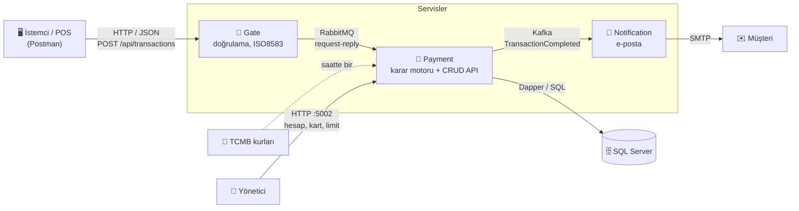

| Servis | Görevi |
|---|---|
| **Gate** | Sistemin tek giriş kapısı. JSON'u ISO 8583 kurallarına göre doğrular, isteği kuyruğa koyar, cevabı bekler. İş kuralı bilmez |
| **Payment** | Sistemin beyni. İşlemi karara bağlar, parayı hareket ettirir, kaydı yazar, olay yayımlar. Hesap/kart/limit yönetim API'si de buradadır |
| **Notification** | Kafka'daki olayları dinler, onaylı işlemlerde müşteriye e-posta atar |

**Teknolojiler:** .NET 9 (C#) · ASP.NET Core · Dapper · SQL Server 2022 · RabbitMQ · Apache Kafka · MailKit (SMTP) ·
Docker Compose · xUnit + Testcontainers · GitHub Actions · Swagger / OpenAPI

## 📸 Ekran görüntüleri

Aşağıdaki görüntüler, bir kredi kartıyla yapılan 3 taksitli 300 TL'lik satışın sistemdeki yolculuğunu sırayla gösteriyor:
istek geliyor → karar veriliyor → veritabanına yazılıyor → müşteriye e-posta gidiyor.

### 1. İstek ve cevap (Postman)

| ✅ Onaylanan satış: 300 TL, 3 taksit | ❌ Reddedilen satış: 5.000 TL, limit yetmiyor |
|---|---|
| 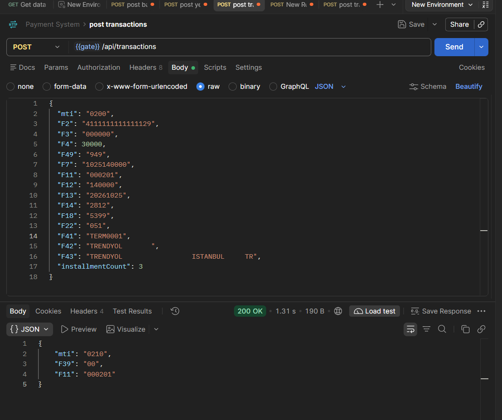 | 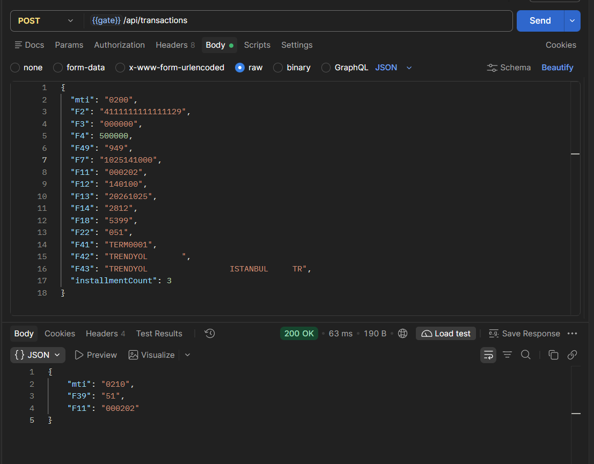 |
| Cevap `F39: "00"`: işlem onaylandı | Cevap `F39: "51"`: yetersiz limit. HTTP yine `200`, çünkü karar F39'da |

### 2. Veritabanı (DBeaver)

**Şema.** `PaymentSystem` veritabanının tabloları (DBeaver ER diyagramı):

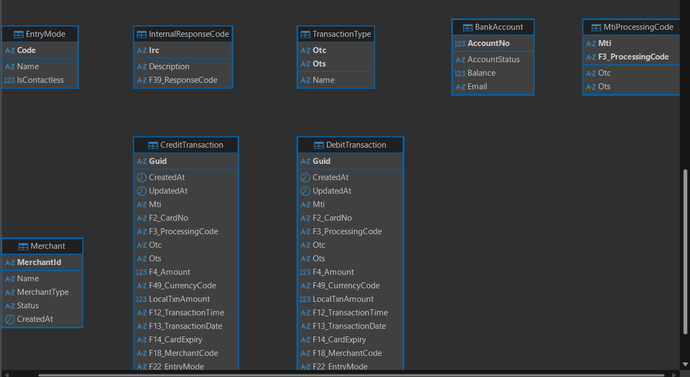

- Üst sıradakiler **tanım tabloları**: giriş yöntemleri, iç cevap kodları (IRC), işlem tipleri, MTI eşlemeleri. Bunlar işyerleriyle
  birlikte seed edilir.
- Alttaki iki tablo **işlem kayıtları**: `CreditTransaction` ve `DebitTransaction`. Kolon adları ISO alan numarasını taşır (`F2_CardNo`, `F4_Amount` …).

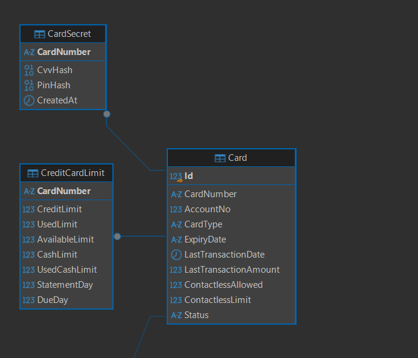

Kart numarası üzerinden `Card`'a bağlı tablolar:
- `CardSecret`: CVV ve PIN'in sadece hash'leri.
- `CreditCardLimit`: kredi kartının limiti.
- `Statement`: ekstre. Görüntüde aşağı inen çizgi.

Kart silinince bunlar da cascade ile silinir.

**Kayıtlar.**

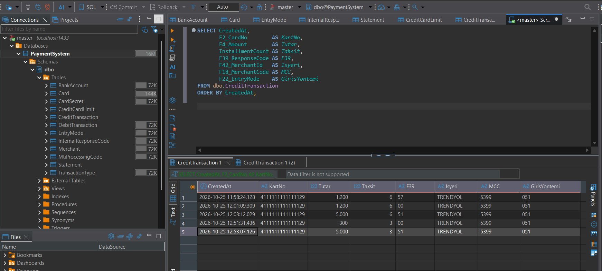

Kredi kartıyla yapılan her işlem, onaylansa da reddedilse de `CreditTransaction` tablosuna kendi F39'uyla bir satır olarak yazılır:
- `57` = limit henüz tanımlı değildi
- `00` = onaylandı
- `51` = limit yetmedi

Taksit sayısı, işyeri (F42), MCC (F18) ve giriş yöntemi (F22) de kayıtta durur. Hiçbir kolon boş kalmaz.

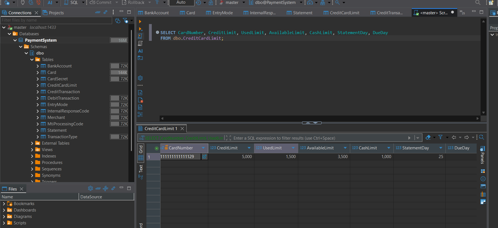

Kartın limiti 5.000 TL. Onaylanan iki satış (1.200 + 300) kullanılan limiti 1.500'e çıkardı, kullanılabilir limit 3.500 kaldı.
Reddedilen satışlar limite dokunmadı.

### 3. Müşteriye giden e-posta

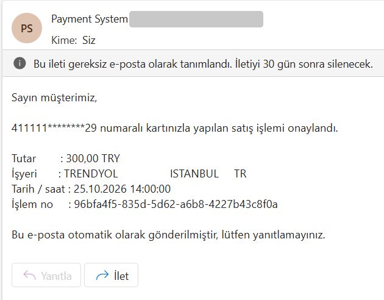

Onaylanan satıştan birkaç saniye sonra Notification servisi Kafka'daki olayı okuyup müşteriye e-posta atar. Kart numarası
burada da maskelidir (`411111********29`).

### 4. Payment logu

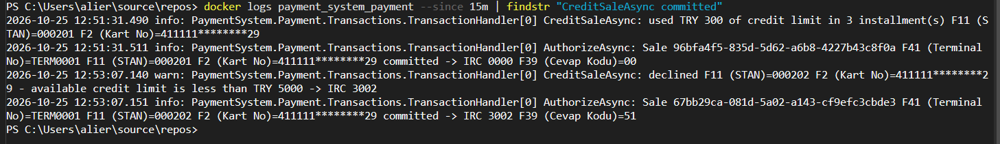

Her kararın asıl sebebi, yani iç kod (IRC), logda yazar: onayda `IRC 0000 → F39 00`, reddedilende
`available credit limit is less than TRY 5000 → IRC 3002 → F39 51`. Kart numarası loglarda da maskelidir (PCI).

### 5. Çalışan servisler (Docker Desktop)

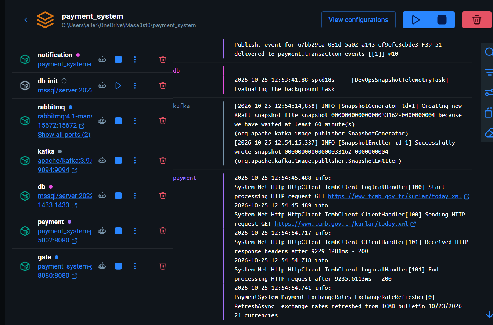

`docker compose up` ile 7 container ayağa kalkar:
- servisler: `gate`, `payment`, `notification`
- altyapı: `db`, `rabbitmq`, `kafka`
- şemayı kurup kapanan `db-init`

Sağda Payment'ın, saatlik TCMB kur çekimini yaptığı an görünüyor.

### 6. CI (GitHub Actions)

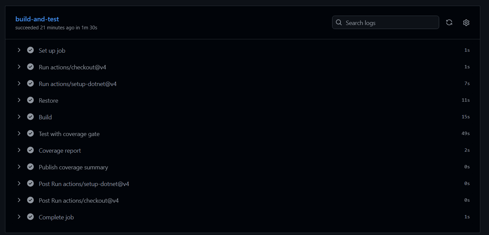

Her PR'da build ve testler çalışır. Coverage %80'in altına düşerse PR merge edilemez.

### 7. Payment yönetim API'si (Swagger)

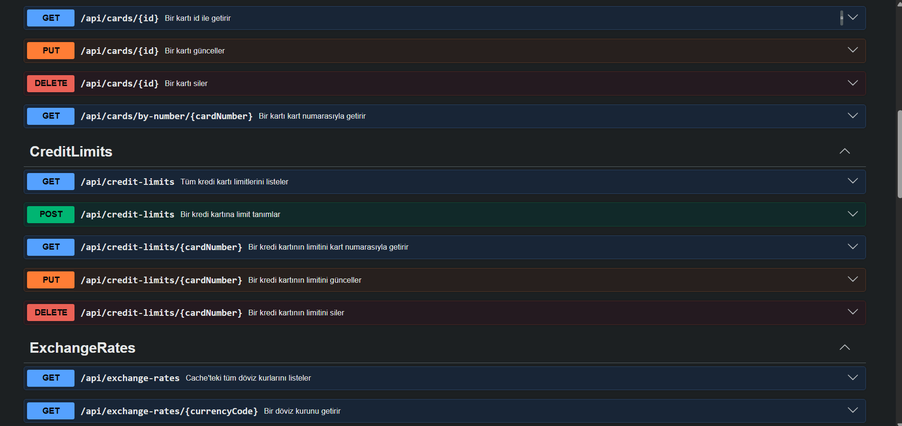

<details>
<summary>Diğer endpoint'ler (hesaplar, kartlar, işyerleri, işlem tipleri)</summary>

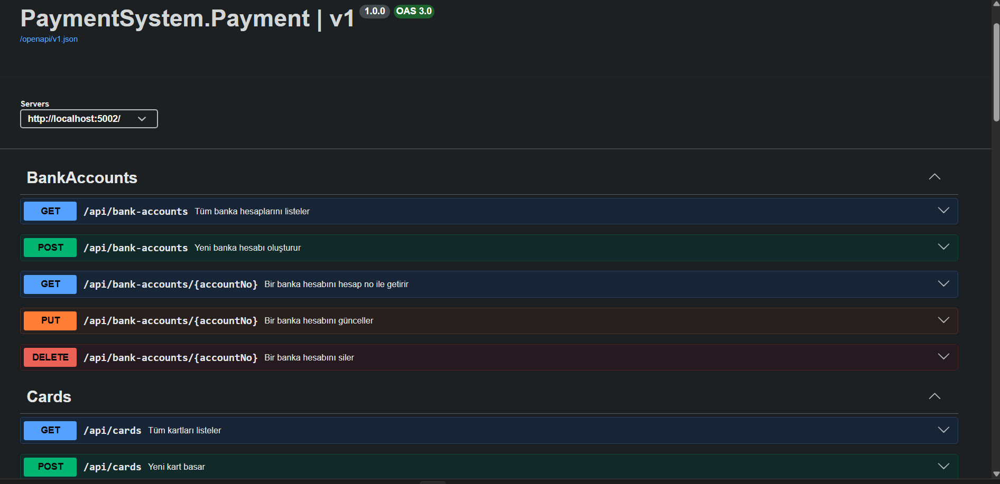
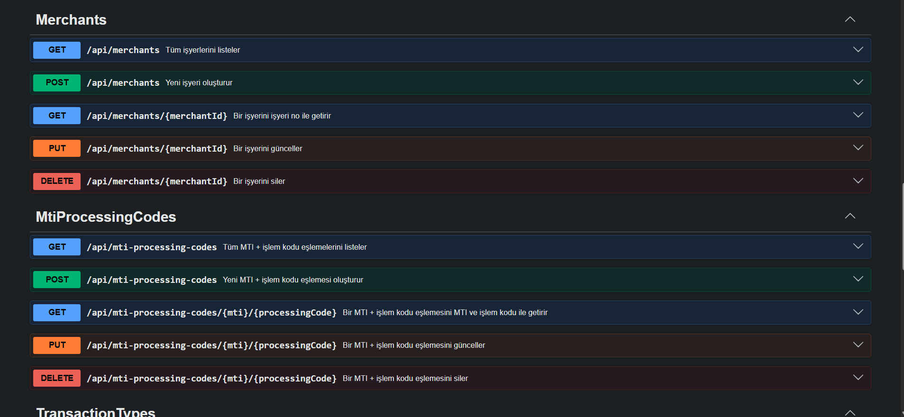
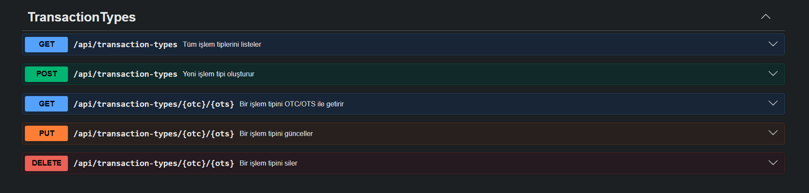

</details>

## ✅ Kalite

- **429 otomatik test.** Testler sahte değil, Testcontainers ile açılan **gerçek** SQL Server, RabbitMQ, Kafka ve SMTP (Mailpit) container'larına karşı koşar.
- **Coverage:** Payment %98, Gate %100, Notification %94.
- **CI:** GitHub Actions her PR'da build ve testleri çalıştırır. Coverage %80'in altına düşerse PR merge edilemez.
- **Branch akışı:** geliştirme `develop`'ta yapılır, `master`'a sadece PR ile girer.

---

## 📚 Detaylı dokümantasyon

Aşağıdaki bölümler projeyi **öğrenmek** için yazıldı: önce büyük resim ve kavramlar, sonra bir işlemin baştan sona
yolculuğu, ardından her endpoint'in tek tek anlatımı gelir.

---

## 1. Büyük resim

```
                         (1) HTTP/JSON                (2) RabbitMQ request-reply
 İstemci (Postman/POS) ───────────────────► GATE ─────────────────────────────► PAYMENT ──(3) SQL──► SQL Server
                       POST :8080             │      kuyruk: payment.transactions │
                       /api/transactions      │                                   │
                       ◄──────────────────────┘ ◄─────── amq.rabbitmq.reply-to ───┘
                         (6) { mti, F39, F11 }           (5) { responseCode }      │
                                                                                   │ (4) Kafka (bloklamadan)
                                                         topic: payment.transaction-events
                                                                                   ▼
                                                                             NOTIFICATION ──SMTP──► müşterinin e-postası

 Yönetici (Postman) ──HTTP──► PAYMENT :5002  (hesap, kart, kredi limiti, işyeri, tanım tabloları CRUD + kur cache'i)
                                 ▲
                     TCMB today.xml (saatte bir kur çekilir)
```

| Servis / parça | Klasör | Ne yapar | Port |
|---|---|---|---|
| **Gate** | `src/PaymentSystem.Gate` | İşlemlerin **tek giriş kapısı**. JSON'u ISO8583 kurallarına göre doğrular, isteği RabbitMQ ile Payment'a gönderir, cevabı bekleyip istemciye döner. İş kuralı bilmez. | `8080` |
| **Payment** | `src/PaymentSystem.Payment` | Sistemin **beyni**. Kuyruktan gelen işlemi karara bağlar (onay / red), parayı hareket ettirir, kaydı yazar, Kafka'ya olay basar. Ayrıca yönetim için CRUD API sunar. | `5002` |
| **Notification** | `src/PaymentSystem.Notification` | Kafka'daki olayları dinler; onaylı satış ve transferlerde müşteriye e-posta atar. HTTP endpoint'i yoktur. | — |
| **Iso8583** kütüphanesi | `src/PaymentSystem.Iso8583` | ISO8583 mesaj modeli, alan tanımları, pack/unpack, TCP framing, PAN maskeleme ve log biçimi. Gate ve Payment ortak kullanır. | — |
| SQL Server | `docker/sql` | Hesaplar, kartlar, işlemler, tanım tabloları. | `1433` |
| RabbitMQ | `docker-compose.yml` | Gate ↔ Payment arası senkron (request-reply) haberleşme. | `5672`, arayüz `15672` |
| Kafka | `docker-compose.yml` | Payment'ın "ne oldu" olayları; asenkron tüketiciler için. | `9094` |

**Neden üç ayrı servis?**

- **Gate** dış dünyaya açık kapıdır: format kontrolü, protokol çevirisi. İş kuralı burada olmaz; böylece ileride TCP/ISO8583 gibi
  başka bir giriş eklense de karar mantığı tek yerde (Payment) kalır.
- **Payment** ile Gate arasında kuyruk olması, Payment kapalıyken bile Gate'in ayakta kalmasını ve kontrollü `91` dönmesini sağlar.
- **Notification** işlemi bekletmemeli: e-posta sunucusu yavaş ya da kapalıysa satış yine de anında onaylanmalı. Bu yüzden
  Kafka üzerinden asenkron çalışır. Yarın fraud/raporlama gibi yeni tüketiciler Payment'a dokunmadan eklenebilir.

---

## 2. Temel kavramlar (sözlük)

Kodda ve bu dokümanda sürekli geçen terimler:

| Terim | Anlamı |
|---|---|
| **ISO 8583** | Kartlı ödeme mesajlarının uluslararası standardı. Mesaj = MTI + bitmap + numaralı alanlar (F2, F3, …). Bu projede 1987 sürümü kullanılır. |
| **MTI** | Message Type Indicator, 4 hane. `0200` = finansal istek, `0210` = onun cevabı. 3. hane çiftse istek, tekse cevaptır (`0800`→`0810`). |
| **Bitmap** | Mesajda hangi alanların bulunduğunu gösteren bit dizisi. n. bit 1 ise Fn mesajda vardır. (`IsoMessagePacker`) |
| **F2 – PAN** | Kart numarası (Primary Account Number). Loglarda daima maskelidir: `411111********11`. |
| **F3 – Processing code** | İşlemin türü: `000000` satış, `310000` bakiye sorgu, `400000` karttan karta transfer. |
| **F4 – Tutar** | Kuruş cinsinden: `15000` = 150,00. |
| **F11 – STAN** | System Trace Audit Number: terminalin işleme verdiği sıra no. İstemci cevabı isteğiyle bununla eşleştirir. |
| **F14** | Kartın son kullanma tarihi, `YYMM`. (DB'deki `Card.ExpiryDate` ise `MMYY`.) |
| **F18 – MCC** | Merchant Category Code: işyeri tipi (`5411` market, `5399` genel mağaza, `4829` para transferi …). İstekteki F18, işyerinin tablodaki MCC'siyle aynı olmalı. |
| **F22 – Entry mode** | Kartın nasıl okunduğu: `05x` çip, `07x` temassız, `01x` elle giriş, `81x` e-ticaret. |
| **F39 – Response code** | Kararın kendisi: `00` onay, `51` yetersiz bakiye, `14` geçersiz kart, `91` sistem ulaşılamıyor … |
| **F41 / F42 / F43** | Terminal no / işyeri no / işyeri adı-yeri. F42 ve F43 sabit uzunluktadır (15 / 40), kısa değer sağdan boşlukla doldurulur. Transferde F42 bir mağaza değil, işlemin başladığı **kanaldır** (mobil uygulama, ATM). |
| **F48** | "Ek veri" alanı; bu sistemde **transferde alıcı kart no**. |
| **F49** | Para birimi, ISO 4217 sayısal: `949` TRY, `840` USD, `978` EUR. |
| **Debit / kredi kartı** | `Card.CardType`. **Debit** kartla yapılan satış bağlı banka hesabının bakiyesinden düşer. **Kredi** kartıyla (`Credit`) yapılan satış hesaba dokunmaz, kartın **limitinden** (`CreditCardLimit`) düşer; kayıt `CreditTransaction` tablosuna yazılır. |
| **Kullanılabilir limit** | `CreditLimit − UsedLimit`. Kredi kartıyla satış ancak tutar buna sığarsa onaylanır (`AvailableLimit`, DB hesaplar). |
| **Taksit** | `installmentCount`: satışın kaç taksite bölündüğü. ISO8583:1987'de alanı yoktur, JSON'da ayrı alanla gelir. Sadece kredi kartıyla satışta 1'den büyük olabilir; toplam tutar limitten **bir kerede** düşer. |
| **Kart durumu** | `Card.Status`: `Active`, `Blocked`, `Cancelled`. `Active` olmayan kartla hiçbir işlem yapılamaz (`62`). |
| **CVV2** | Kartın arkasındaki 3-4 hane. ISO8583:1987'de alanı yoktur, JSON'da ayrı `cvv` alanıyla gelir. Kart fiziksel olarak yokken (elle giriş, e-ticaret) zorunludur. |
| **IRC** | Internal Response Code. Payment'ın kararı önce 4 haneli bir iç koddur (`3002` = bakiye yetersiz); POS'a dönen F39 bir tablodan (`InternalResponseCode`) bulunur. Böylece birkaç sebep aynı F39'a çıkabilir ve eşleme kod değiştirmeden değişebilir. IRC DB kaydında tutulmaz; **Payment logunda** ve Kafka olayında görünür. |
| **Otc / Ots** | İşlem tipini tanımlayan iki haneli kod çifti. `MTI + F3 → (Otc, Ots) → işlem adı` (`Sale`, `MoneyTransfer`, `BalanceInquiry`). |
| **On-us** | Gönderen ve alıcı kartın ikisi de bu bankada. Bu sistemdeki transfer sadece on-us'tır. |
| **Request-reply** | Kuyruk üzerinden "istek gönder, cevabını bekle" kalıbı. `CorrelationId` ile istek-cevap eşleşir. |
| **Idempotency** | Aynı istek iki kez gelirse sonucun bir kez olması (para iki kez düşmemesi). |
| **TTL** | Time To Live: kuyruktaki mesajın ömrü. Süresi dolan istek silinir. |
| **Consumer group** | Kafka'da bir topic'i okuyan tüketici grubu. Her grup tüm olayları bağımsız okur. |
| **PCI DSS** | Kart verisi güvenlik standardı. Gereği: tam PAN loglanmaz, CVV hiç saklanmaz. |

---

## 3. Kurulum ve çalıştırma

### Gereksinimler
- Docker Desktop
- .NET 9 SDK (sadece lokal çalıştırma ve testler için)
- Postman ya da VS Code / Rider'ın `.http` dosya desteği

### İlk kurulum
```bash
cp .env.example .env
```
`.env` içini doldur:

| Anahtar | Açıklama |
|---|---|
| `MSSQL_SA_PASSWORD` | SQL Server `sa` şifresi (güçlü olmalı, yoksa SQL Server açılmaz) |
| `RABBITMQ_PASSWORD` | RabbitMQ `payment` kullanıcısının şifresi |
| `CARD_SECRET_KEY` | CVV/PIN hash anahtarı, **64 hex karakter**. PowerShell: `-join ((1..32) \| % { '{0:X2}' -f (Get-Random -Max 256) })` |
| `SMTP_USER`, `SMTP_PASSWORD` | Gmail adresi ve 16 haneli uygulama şifresi (bkz. [Notification](#12-notification-servisi)). **Boşsa Notification servisi açılmaz**, diğerleri çalışır. |

### Hepsini ayağa kaldır
```bash
docker compose up -d --build
docker compose ps
```

Açılış sırası compose'daki `depends_on` ile garanti edilir:

```
db (healthy) ──► db-init (SQL script'leri çalışır, biter) ──┐
rabbitmq (healthy) ─────────────────────────────────────────┼──► payment
kafka (healthy) ────────────────────────────────────────────┘      │
rabbitmq (healthy) ──► gate                                   kafka ──► notification
```

`db-init`, `docker/sql/init/` altındaki script'leri sırayla çalıştırıp `PaymentSystem` veritabanını, tabloları ve seed
verisini oluşturur. Script'ler idempotent'tir (`IF NOT EXISTS` / `MERGE`), her açılışta tekrar çalışması zararsızdır.

| Adres | Ne |
|---|---|
| http://localhost:8080/api/transactions | Gate — işlem girişi |
| http://localhost:5002/api/... | Payment — yönetim API'si |
| http://localhost:8080/swagger | Gate Swagger UI |
| http://localhost:5002/swagger | Payment Swagger UI |
| http://localhost:15672 | RabbitMQ arayüzü (`payment` / `RABBITMQ_PASSWORD`) |
| `localhost:1433` | SQL Server (DBeaver vb. ile bağlanırken Database: `PaymentSystem`) |

### Loglar
```bash
docker logs -f payment_system_gate
docker logs -f payment_system_payment
docker logs -f payment_system_notification
```
Loglar tek satırlıdır ve her satır metot adıyla başlar (`HandleAsync: ...`). ISO alanları her iki serviste de aynı biçimde
yazılır: `F2 (Kart No)=411111********11 F11 (STAN)=000001`. Bir işlemi Gate ve Payment loglarında STAN ile takip edebilirsin.

### Veriyi sıfırlamak
```bash
docker compose down      # container'lar gider, DB verisi kalır (volume: payment_system_mssql_data)
docker compose down -v   # DB verisi de silinir
```
Kafka'nın volume'ü yoktur; olaylar `down` ile silinir.

### Bir servisi lokalde (IDE'den) çalıştırmak
Aynı portu kullandıkları için önce ilgili container'ı durdur (`docker stop payment_system_payment`).

```powershell
# Payment (DB, RabbitMQ, Kafka container'ları ayakta olmalı)
$env:MSSQL_SA_PASSWORD = "<şifre>"; $env:RABBITMQ_PASSWORD = "<şifre>"; $env:CARD_SECRET_KEY = "<64 hex>"
dotnet run --project src/PaymentSystem.Payment --launch-profile http      # http://localhost:5002

# Gate
$env:RABBITMQ_PASSWORD = "<şifre>"
dotnet run --project src/PaymentSystem.Gate --launch-profile http         # http://localhost:8080

# Notification
$env:Smtp__User = "gonderen@gmail.com"; $env:Smtp__Password = "<uygulama şifresi>"
dotnet run --project src/PaymentSystem.Notification
```
Lokalde Kafka adresi `localhost:9094`, container içinde `kafka:9092`'dir (compose iki listener açar).

### Swagger (API dokümanı ve deneme arayüzü)
Swagger (OpenAPI), API'nin makinece okunabilen tarifidir: hangi endpoint var, hangi gövdeyi alır, hangi durum kodlarıyla
ne döner. Tarif koddan üretilir, kod değişince kendiliğinden güncellenir.

| Adres | Ne |
|---|---|
| http://localhost:8080/swagger · http://localhost:5002/swagger | Swagger UI: endpoint'leri gör, "Try it out" ile tarayıcıdan istek at |
| http://localhost:8080/openapi/v1.json · http://localhost:5002/openapi/v1.json | Ham OpenAPI şeması: Postman'a import edilebilir |

- Şemayı .NET 9'un yerleşik `Microsoft.AspNetCore.OpenApi` paketi üretir (`AddOpenApi` / `MapOpenApi`); arayüz
  `Swashbuckle.AspNetCore.SwaggerUI` paketinden gelir ve sadece bu şemayı gösterir.
- İkisi de `Swagger:Enabled` ayarıyla açılır (varsayılan `true`), ortamdan bağımsızdır: hem Docker'da hem lokalde çalışır.
  Kapatmak için: `Swagger__Enabled=false`.
- Açıklamalar koddan gelir: Gate'te `.WithSummary` / `.WithDescription` ve istek alanlarındaki `[Description]`
  (F2, F3 ... ne demek); Payment'ta action'lardaki `[EndpointSummary]` ve `[ProducesResponseType]` (hangi durum kodu döner).
  Gate'in `POST /api/transactions` gövdesi örnek bir satış isteğiyle dolu gelir (`Program.cs`'teki operation transformer).
- ⚠️ "Try it out" ile atılan istek **gerçektir**: Gate'teki örnek satış onaylanırsa bakiye düşer, kayıt açılır, e-posta gider.
  Aynı örneği ikinci kez gönderirsen tekrar sayılır ([11.1](#111-idempotency-aynı-istek-iki-kez-gelirse)); yeni işlem için F11/F12'yi değiştir.

---

## 4. Uygulamalı lab: sıfırdan uçtan uca test

Bu bölümde boş bir veritabanından başlayıp sistemi baştan sona test ediyorsun: önce veriyi oluşturuyorsun, sonra bir satış
ve bir karttan karta transfer (KKPT) yapıyorsun, ardından sistemi bilerek reddettiriyorsun. En sonda bir kredi kartı açıp
taksitli satış yapıyorsun. Her adımda **ne beklediğini**
ve **nasıl doğrulayacağını** göreceksin. İstekleri Postman'den, Swagger'dan ya da hazır `.http` dosyalarından
(`src/PaymentSystem.Payment/PaymentSystem.Payment.http`, `src/PaymentSystem.Gate/PaymentSystem.Gate.http`) atabilirsin.

> **Bir sonucu doğrulamanın üç yolu var**, lab boyunca üçünü de kullan:
>
> | Nereye bakıyorsun | Ne görürsün | Nasıl |
> |---|---|---|
> | Payment API | Bakiye, kartın son işlemi | `GET /api/bank-accounts/{no}`, `GET /api/cards` |
> | Veritabanı | İşlem kaydının kendisi (`DebitTransaction` / `CreditTransaction`) | `sqlcmd` (bkz. [4.8](#48-veritabanından-son-kontrol)) |
> | Loglar | Kararın **asıl sebebi** (IRC) | `docker logs payment_system_payment` |

### 4.0 Hazırlık
```bash
docker compose up -d --build
docker compose ps          # db, payment, gate, rabbitmq, kafka, notification "Up"; db-init çalışıp biter
```
Tanım tabloları (işlem tipleri, giriş yöntemleri, cevap kodları, işyerleri) `db-init` ile **otomatik dolar**; hesap ve kart
gelmez. Önce seed'in geldiğini gör:
```http
GET http://localhost:5002/api/merchants               # TRENDYOL (5399), GETIR, IYZICO, NETFLIX
GET http://localhost:5002/api/mti-processing-codes    # 000000 satış, 400000 transfer, 310000 bakiye sorgu
```

### 4.1 Veriyi oluştur
> **Kural: boş kolonlu kayıt açılmaz.** Hesapta ve kartta her alan zorunludur. Tek istisnalar: kartın `lastTransaction*`
> alanları (yeni kartta işlem yok) ve temassıza kapalı kartın `contactlessLimit`'i. Eksik alan → `400`. Ayrıntı: [10.1](#101-boş-kalabilen-kolonlar).

**Gönderen hesap ve kartı**
```http
POST http://localhost:5002/api/bank-accounts
Content-Type: application/json

{ "accountNo": 1000000001, "accountStatus": "Active", "balance": 1000.00, "email": "sen@example.com" }
```
```http
POST http://localhost:5002/api/cards
Content-Type: application/json

{ "cardNumber": "4111111111111111", "accountNo": 1000000001, "cardType": "Debit",
  "expiryDate": "1228", "contactlessAllowed": true, "contactlessLimit": 750.00 }
```
Cevapta kartın `cvv` ve `pin`'i **bir kez** döner — not al, bir daha hiçbir yerde göremezsin (DB'de sadece hash'leri var):
```json
{ "id": 1, "cardNumber": "4111111111111111", "accountNo": 1000000001, "cardType": "Debit", "expiryDate": "1228",
  "lastTransactionDate": null, "lastTransactionAmount": null, "contactlessAllowed": true, "contactlessLimit": 750.00,
  "cvv": "482", "pin": "0731" }
```

**Alıcı hesap ve kartı** (transfer için; alıcı **başka bir hesapta** olmalı)
```http
POST http://localhost:5002/api/bank-accounts
Content-Type: application/json

{ "accountNo": 1000000002, "accountStatus": "Active", "balance": 500.00, "email": "alici@example.com" }
```
```http
POST http://localhost:5002/api/cards
Content-Type: application/json

{ "cardNumber": "5406680000000002", "accountNo": 1000000002, "cardType": "Debit",
  "expiryDate": "1228", "contactlessAllowed": true, "contactlessLimit": 750.00 }
```

**Transfer kanalı.** F42 her işlemde zorunludur, transferde de. Ama transferde F42 bir mağazayı değil, işlemin **başladığı
kanalı** (mobil uygulama, ATM, fintech) anlatır ve MCC'si genelde `4829` (Money Transfer) olur. "Trendyol'da para transferi"
anlamsız olacağı için bir kanal ekle:
```http
POST http://localhost:5002/api/merchants
Content-Type: application/json

{ "merchantId": "MOBILEBANK", "name": "MOBILE BANKING", "merchantType": "4829", "status": "Active" }
```

### 4.2 Satış
```http
POST http://localhost:8080/api/transactions
Content-Type: application/json

{
  "mti": "0200",
  "F2": "4111111111111111",
  "F3": "000000",
  "F4": 15000,
  "F49": "949",
  "F7": "1021100000",
  "F11": "000001",
  "F12": "100000",
  "F13": "20261021",
  "F14": "2812",
  "F18": "5399",
  "F22": "051",
  "F41": "TERM0001",
  "F42": "TRENDYOL       ",
  "F43": "TRENDYOL                 ISTANBUL     TR"
}
```
Alanları okumayı öğren:

| Alan | Değer | Neden böyle |
|---|---|---|
| `F4` | `15000` | Tutar **kuruş** cinsinden: 150,00 TL |
| `F14` | `2812` | Kartın son kullanması `YYMM`. Karttaki `expiryDate` ise `MMYY` (`1228`) — ters yazılır! |
| `F18` | `5399` | İşyerinin MCC'siyle **aynı** olmalı (TRENDYOL = 5399) |
| `F22` | `051` | Çip. Kart fiziksel olarak okunduğu için CVV istenmez |
| `F42` | `"TRENDYOL       "` | Sabit **15** karakter: kısa no sağdan boşlukla doldurulur |
| `F43` | 40 karakter | Sabit **40**: 25 isim + 13 şehir + 2 ülke |
| `F11` / `F12` | `000001` / `100000` | Her yeni işlemde değiştir (bkz. [4.5](#45-aynı-isteği-tekrar-gönder-idempotency)) |

**Beklenen:** `{ "mti": "0210", "F39": "00", "F11": "000001" }`

**Doğrula:** `GET /api/bank-accounts/1000000001` → `balance: 850.00`. `GET /api/cards/1` → `lastTransactionAmount: 150.00`.
E-posta ayarlıysa "Kartınızla 150,00 TRY tutarında satış yapıldı" maili gelir.

### 4.3 Karttan karta transfer (KKPT)
Satıştan farkı: `F3 400000`, `F48` = alıcı kart no, kanal `MOBILEBANK` / `4829`.
```http
POST http://localhost:8080/api/transactions
Content-Type: application/json

{
  "mti": "0200",
  "F2": "4111111111111111",
  "F3": "400000",
  "F4": 20000,
  "F49": "949",
  "F7": "1021101000",
  "F11": "000002",
  "F12": "101000",
  "F13": "20261021",
  "F14": "2812",
  "F18": "4829",
  "F22": "051",
  "F41": "TERM0001",
  "F42": "MOBILEBANK     ",
  "F43": "MOBILE BANKING           ISTANBUL     TR",
  "F48": "5406680000000002"
}
```
**Beklenen:** `F39 00`. **Doğrula:** gönderen `650.00`, alıcı `700.00`. İki tarafa da e-posta gider. Düşme ve ekleme
aynı SQL transaction'ındadır: ya ikisi birden olur ya hiçbiri.

### 4.4 Red senaryoları: sistemi bilerek reddettir
4.3'teki transfer gövdesini al; her senaryoda **sadece tablodaki alanı** değiştir, `F11` ve `F12`'yi de yeni bir değer yap
(örn. `000003` / `110000`, `000004` / `111000` …).

| Senaryo | Değiştir | Beklenen F39 | IRC (logda) | Ne öğretiyor |
|---|---|---|---|---|
| Yetersiz bakiye | `F4: 100000` (1.000 TL) | `51` | `3002` | Bakiye kontrolü ve düşme tek SQL'de (`WHERE Balance >= @amount`) |
| Aynı hesaba transfer | `F48: "4111111111111111"` | `12` | `1006` | Alıcı kart **başka hesapta** olmalı |
| Yanlış MCC | `F18: "5399"` | `03` | `4003` | F18 işyerinin MCC'siyle aynı olmalı |
| Bilinmeyen işyeri | `F42: "BILINMEYEN     "` | `03` | `4001` | F42 `Merchant` tablosunda olmalı |
| Olmayan kart | `F2: "4000000000000001"` | `14` | `2001` | |
| Olmayan alıcı | `F48: "5406680000000099"` | `14` | `2007` | |
| E-ticaret, CVV yok | `F3: "000000"`, `F22: "812"`, `F18: "5399"`, `F42`/`F43`: TRENDYOL, `F48`'i sil | `N7` | `2006` | Kart fiziksel yokken CVV2 zorunlu; `"cvv": "<4.1'de not aldığın>"` ekleyince `00` |

Her redde HTTP yine **`200`**'dür; karar `F39`'dadır. Bakiyeler değişmez. Reddedilen işlem de `DebitTransaction`'a
kendi F39'uyla yazılır (iz kalsın diye) ama kartın `lastTransaction*`'ı güncellenmez ve e-posta gitmez.

**Aynı F39, farklı sebep: IRC'yi nereden göreceksin?** `InternalResponseCode` tablosunda F39'u `12` olan beş satır var
(`1001`, `1002`, `1003`, `1004`, `1006`). F39 POS'a giden **kaba** koddur; asıl sebep IRC'dir ve DB kaydında tutulmaz.
Logda her redde yazılır:
```bash
docker logs payment_system_payment --since 10m | findstr IRC        # Linux/macOS: grep IRC
```
```
TransferAsync: declined F11 (STAN)=000004 ... F48 (Alıcı Kart No)=411111********11 is on the same account 1000000001 -> IRC 1006
DecideAsync: ... not approved: F39 (Cevap Kodu)=12 Transfer to the same account (IRC 1006) transaction d5f71c98-... account 1000000001
```
Logdaki `transaction` Guid'i `DebitTransaction.Guid` ile aynıdır: log satırını DB kaydıyla böyle eşleştirirsin. IRC ayrıca
Kafka olayında (`irc` alanı) taşınır. Gerçek bankalarda da böyledir: dışarıya kaba kod, ayrıntı bankanın içinde kalır.

### 4.5 Aynı isteği tekrar gönder (idempotency)
4.3'teki onaylı transferi **hiçbir alanını değiştirmeden** tekrar gönder.

**Beklenen:** yine `F39 00` (ilk kararın kendisi), ama bakiyeler **değişmez**, `DebitTransaction`'a yeni satır **açılmaz**.
Logda: `PreviousResponseAsync: duplicate request ... - returning previous F39 (Cevap Kodu)=00`.

Neden? Kaydın anahtarı isteğin `MTI | F2 | F3 | F4 | F13 | F12` alanlarından üretilir; aynı istek aynı anahtarı üretir ve
ikinci `INSERT` PK'ya takılır (bkz. [11.1](#111-idempotency-aynı-istek-iki-kez-gelirse)). Yeni bir işlem yapmak
istediğinde bu yüzden en az `F12`'yi değiştirmen gerekir.

### 4.6 Kredi kartıyla taksitli satış
Aynı hesaba (`1000000001`) bir **kredi kartı** aç. Kredi kartı da bir hesaba bağlıdır (hesap `Active` değilse çalışmaz), ama
satış hesabın bakiyesinden değil kartın limitinden düşer.
```http
POST http://localhost:5002/api/cards
Content-Type: application/json

{ "cardNumber": "4111111111111129", "accountNo": 1000000001, "cardType": "Credit",
  "expiryDate": "1228", "contactlessAllowed": true, "contactlessLimit": 750.00 }
```
Limit tanımlanmadan bu kartla satış `57` alır (IRC `3003`). Limiti tanımla:
```http
POST http://localhost:5002/api/credit-limits
Content-Type: application/json

{ "cardNumber": "4111111111111129", "creditLimit": 5000.00, "cashLimit": 1000.00, "statementDay": 25, "dueDay": 5 }
```
Cevapta `usedLimit: 0`, `availableLimit: 5000.00` döner. Şimdi 4.2'deki satış gövdesini al; `F2`'yi kredi kartı yap, yeni bir
`F11`/`F12` ver ve **6 taksit** iste:
```json
{ "mti": "0200", "F2": "4111111111111129", "F3": "000000", "F4": 120000, "F49": "949",
  "F7": "1021120000", "F11": "000020", "F12": "120000", "F13": "20261021", "F14": "2812", "F18": "5399", "F22": "051",
  "F41": "TERM0001", "F42": "TRENDYOL       ", "F43": "TRENDYOL                 ISTANBUL     TR",
  "installmentCount": 6 }
```
**Beklenen:** `F39 00`. **Doğrula:** `GET /api/credit-limits/4111111111111129` → `usedLimit: 1200.00`,
`availableLimit: 3800.00`. Hesabın bakiyesi **değişmez**. Taksitli olsa da tutarın tamamı limitten bir kerede düşer;
taksit sayısı `CreditTransaction.InstallmentCount`'ta durur (taksitlerin ekstrelere bölünmesi ekstre adımında gelecek).

Sonra kredi kartını reddettir (her seferinde yeni `F11`/`F12`):

| Senaryo | Değiştir | Beklenen F39 | IRC | Ne öğretiyor |
|---|---|---|---|---|
| Limit yetersiz | `F4: 500000` (5.000 TL) | `51` | `3002` | Kontrol ve düşme tek SQL'de (`WHERE CreditLimit - UsedLimit >= @amount`) |
| Debit kartla taksit | `F2: "4111111111111111"` | `57` | `1008` | Taksit sadece kredi kartıyla satışta olur |
| Geçersiz taksit | `installmentCount: 0` ya da `37` | HTTP `400` | — | Gate 1–36 dışını Payment'a hiç göndermez |
| Bloke kart | önce `PUT /api/cards/{id}` ile `"status": "Blocked"` | `62` | `2009` | `Active` olmayan kartla (debit de olsa) işlem yapılamaz |

### 4.7 Lab sonunda beklenen durum
| | Başlangıç | Satış | KKPT | Redler + tekrar | **Son** |
|---|---|---|---|---|---|
| Gönderen (1000000001) | 1000,00 | −150 | −200 | 0 | **650,00** |
| Alıcı (1000000002) | 500,00 | | +200 | 0 | **700,00** |

Kredi kartının (`4111111111111129`) limiti: **5.000,00**, kullanılan **1.200,00**, kullanılabilir **3.800,00**. Kredi kartıyla
satış hesap bakiyelerini etkilemez.

### 4.8 Veritabanından son kontrol
```bash
docker exec -it payment_system_db /opt/mssql-tools18/bin/sqlcmd -S localhost -U sa -P '<MSSQL_SA_PASSWORD>' -C -d PaymentSystem \
  -Q "SELECT CreatedAt, F3_ProcessingCode, F4_Amount, F18_MerchantCode, F39_ResponseCode, F42_MerchantId, F48_RecipientCardNo FROM dbo.DebitTransaction ORDER BY CreatedAt"
```
Her işlem (onay ve red) bir satırdır, tekrar gelen istek satır açmaz. Satışta `F48_RecipientCardNo` NULL'dır; bu kolon
sadece transferde dolar. Başka bir kolonda NULL görüyorsan bir şey ters gitmiştir.

Kredi kartı işlemleri ayrı tablodadır:
```bash
docker exec -it payment_system_db /opt/mssql-tools18/bin/sqlcmd -S localhost -U sa -P '<MSSQL_SA_PASSWORD>' -C -d PaymentSystem \
  -Q "SELECT CreatedAt, F2_CardNo, F4_Amount, F39_ResponseCode, InstallmentCount FROM dbo.CreditTransaction ORDER BY CreatedAt"
```

### 4.9 Bir şey ters giderse
| Ne görüyorsun | Ne demek | Ne yap |
|---|---|---|
| `400` ve **gövde boş** (`content-length: 0`), Gate logunda hiçbir satır yok | JSON **okunamadı**: istek bizim koda hiç ulaşmadı. Eksik virgül/tırnak, yapıştırırken kalan eski metin, ya da sayı olması gereken alan tırnakta (`"F4": "5000"`) | Gövdeyi tamamen sil (Ctrl+A), yeniden yapıştır |
| `400` ve `errors: { "F18": ["F18 is required."] }` | JSON geçerli ama bir alan eksik ya da formatı bozuk; **bizim** doğrulamamız. Hangi alanın ne sorunu olduğu yazar | Belirtilen alanı düzelt |
| `400`, `errors: { "$": ["... missing required properties including: 'balance'"] }` | Hesap/kartta değer tipli zorunlu alan (`balance`, `contactlessAllowed`) body'de yok. Bu hata önce gelir; diğer eksikler o düzelince görünür | Alanı ekle |
| `200` ve `F39` `00` değil | İstek geçerliydi, **sistem reddetti** | IRC'ye logdan bak ([4.4](#44-red-senaryoları-sistemi-bilerek-reddettir)), [Bölüm 9](#9-karar-motoru-kontroller-irc-ve-f39)'daki tabloda bul |
| `F39 00` ama bakiye değişmedi | Tekrar gelen istek: ilk kararın cevabı döndü | `F12`'yi (ve `F11`'i) değiştir |
| Swagger'da "Try it out" → Execute bakiyeyi düşürdü | Swagger örnek gövdesi **gerçek** bir satıştır, sisteme normal işlem olarak gider | Denemeden önce F11/F12/F13'ü değiştir; istemediğin işlemi Postman'deki gibi düşün |
| `F39 91` | Payment 10 sn içinde cevap vermedi ya da döviz kuru yok/bayat | `docker compose ps`, Payment logu; dövizde `GET /api/exchange-rates` |
| E-postaların bir kısmı **Gereksiz**'e, bir kısmı **Diğer**'e düşüyor | Kişisel Gmail'den "kartınızdan para transferi" içerikli otomatik mail, Microsoft'un filtresinde eşiğe yakın puan alıyor; "Diğer" ise sadece sıralama | Bir maili "Gereksiz değil" işaretle, göndereni Güvenilir Gönderenler'e ekle. Gerçek sistemde: kendi alan adı + SPF/DKIM/DMARC + transactional mail servisi |
| `docker ps`: `failed to connect to the docker API` | Docker Desktop kapalı | Docker Desktop'ı aç |

---

## 5. Uçtan uca akış: bir satışın yolculuğu

[4.2](#42-satış)'deki satış isteğinin sistemde izlediği yol, dosya ve metot adlarıyla:

```
İstemci          Gate                              RabbitMQ            Payment                                 SQL        Kafka     Notification
   │ POST /api/transactions                            │                   │                                      │          │            │
   │──────────────►│ ① TransactionEndpoint.HandleAsync │                   │                                      │          │            │
   │               │   JSON → IsoMessage, alan doğrula │                   │                                      │          │            │
   │               │   (hata → 400)                    │                   │                                      │          │            │
   │               │ ② TransactionHandler.ProcessAsync │                   │                                      │          │            │
   │               │   0200 mü? zorunlu alanlar?       │                   │                                      │          │            │
   │               │ ③ RabbitMqPaymentClient           │                   │                                      │          │            │
   │               │   publish (CorrelationId, TTL) ──►│ payment.transactions                                     │          │            │
   │               │   cevabı bekle (≤10 sn)           │──────────────────►│ ④ TransactionQueueConsumer           │          │            │
   │               │                                   │                   │   süresi dolmuş mu? JSON geçerli mi?  │          │            │
   │               │                                   │                   │ ⑤ TransactionHandler.AuthorizeAsync  │          │            │
   │               │                                   │                   │   işlem tipi (cache) → UUID v5        │          │            │
   │               │                                   │                   │   BEGIN TRAN; INSERT DebitTransaction ───────────►│          │            │
   │               │                                   │                   │   kontroller (işyeri, kart, CVV ...)  │          │            │
   │               │                                   │                   │   UPDATE Balance ... WHERE >= amount ─────────────►│          │            │
   │               │                                   │                   │   F39 yaz; COMMIT ─────────────────────────────────►│          │            │
   │               │                                   │                   │ ⑥ olay yayımla (beklemeden) ─────────────────────────────────►│            │
   │               │                                   │ reply-to          │ ⑦ { "responseCode": "00" } + ack     │          │            │
   │               │◄──────────────────────────────────│◄──────────────────│                                      │          │ ⑧ consume  │
   │◄──────────────│ ⑨ { mti: 0210, F39: 00, F11 }     │                   │                                      │          │──────────►│ e-posta
```

### ① Gate: HTTP isteğini al ve doğrula — `Gate/TransactionEndpoint.cs`
- JSON gövdesi `TransactionRequest` record'una bağlanır. JSON alan adları ISO numaralarıdır (`"F2"`), C# tarafında okunur isimler (`CardNumber`).
- `mti` 4 haneli bir **istek** MTI'ı değilse hemen `400`.
- Her alan `Iso87Fields`'taki tanımla (`Fixed`/`LLVar`/`LLLVar`, uzunluk, karakter seti) doğrulanır. `F4` sayı olarak gelir, 12 haneye sıfırla doldurulur.
- `0200` için zorunlu alanlar (`F2 F3 F4 F7 F11 F12 F13 F14 F18 F22 F41 F42 F43 F49`) eksikse hata listesine eklenir. DB'de kolonu olan her alan zorunludur, boş kolonlu kayıt açılmaz; opsiyonel olanlar sadece `F37` (saklanmaz) ve transferin `F48`'i.
- **F13 özel**: JSON'da `yyyymmdd` (gerçek bir tarih olmalı) gelir; ISO mesajına standart `MMDD` olarak girer, yıllı hali ayrıca Payment'a taşınır.
- `cvv` 3 ya da 4 rakam olmalı; değeri hiçbir yere loglanmaz.
- `installmentCount` geldiyse 1–36 arasında olmalı.
- Herhangi bir hata varsa: `400 ValidationProblem` — her alanın hatası ayrı yazılır. İstek Payment'a **gitmez**.

### ② Gate: karar ver ya da ilet — `Gate/TransactionHandler.cs`
- MTI `0200` değilse (örn. `0800`) Payment'a gidilmez, `F39=12` döner.
- `0200` ise zorunlu alanlar tekrar kontrol edilir (savunma amaçlı; eksikse `30`), sonra `PaymentRequest`'e çevrilip iletilir.
- Gate **işlem tipini yorumlamaz** — satış mı transfer mi, Payment karar verir.
- Cevapta istemcinin eşleştirme için kullandığı alanlar (`F2 F3 F4 F7 F11 F12 F13 F37 F41 F42 F49`) geri yansıtılır (echo); HTTP cevabına bunlardan `F11` konur.

### ③ Gate → RabbitMQ — `Gate/Payment/RabbitMqPaymentClient.cs`
- Rastgele bir `CorrelationId` üretilir ve bir `TaskCompletionSource` ile bekleme listesine (`_pending`) eklenir.
- Mesaj `payment.transactions` kuyruğuna yazılır. Özellikleri:
  - `ReplyTo = amq.rabbitmq.reply-to` (RabbitMQ'nun direct reply-to'su; ayrı cevap kuyruğu açılmaz)
  - `Expiration` = `PaymentTimeoutSeconds` (TTL) ve `Timestamp` = gönderim anı
- `PaymentTimeoutSeconds` (10 sn) içinde cevap gelmezse, RabbitMQ'ya ulaşılamazsa ya da cevap bozuksa → `91`. Bu sınıf asla exception fırlatmaz.
- Bağlantı ilk istekte açılır; koparsa bir sonraki istekte yeniden kurulur. Yani RabbitMQ kapalıyken Gate açılır, istekler `91` alır.

### ④ Payment: kuyruktan al — `Payment/Transactions/TransactionQueueConsumer.cs`
- Arka plan servisi (`BackgroundService`); aynı anda en fazla **8** isteği işler (prefetch 8).
- `Timestamp + Expiration` geçmişse istek **işlenmez ve cevaplanmaz**: Gate zaten `91` döndü, şimdi para düşmek yanlış olur.
- JSON okunamıyorsa ya da `TransactionRequest` üzerindeki DataAnnotations geçmiyorsa → `30`.
- `TransactionHandler`'dan ya F39 döner ya `TransactionException` gelir; ikisinde de sadece F39 Gate'e yazılır, mesaj `ack`lenir (asla kuyruğa geri konmaz).

### ⑤ Payment: karar — `Payment/Transactions/TransactionHandler.cs`
1. `MTI + F3 → (Otc, Ots) → işlem adı` bulunur (`ParameterCache`, DB'ye gitmeden). Tanımsızsa `1001 → 12`, **kayıt açılmaz**.
2. TL karşılığı hesaplanır (TL ise kendisi, dövizse cache'teki TCMB kuruyla).
3. İsteğin alanlarından deterministik bir **UUID v5** üretilir; bu, kaydın PK'sıdır.
4. Tek SQL transaction'ı açılır, kart okunur ve kayıt INSERT edilir: kart `Credit` ise `CreditTransaction`'a, değilse (ya da kart yoksa)
   `DebitTransaction`'a. PK çakışırsa → bu bir **tekrar** isteğidir, ilk kararın F39'u (iki tabloda da aranır) döner.
5. Kontroller sırayla yapılır (tam liste: [Bölüm 9](#9-karar-motoru-kontroller-irc-ve-f39)). İlk başarısız kontrol bir IRC döner.
6. IRC → F39 tablodan bulunur, kayda yazılır, **COMMIT**. Reddedilen işlemler de kendi F39'uyla kaydedilir.
7. Onaysa F39 döner; redse commit'ten **sonra** `TransactionException` fırlatılır (kayıt geri alınmasın diye).

### ⑥ Payment → Kafka — `Payment/Events/KafkaTransactionEventPublisher.cs`
Commit edilen her karar (onay ve red) `TransactionCompleted` olayı olarak `payment.transaction-events`'e yazılır. `Produce`
bloklamaz; Kafka kapalı olsa bile Gate'e dönen cevap gecikmez.

### ⑦ – ⑨ Cevap geri döner
Payment `{ "responseCode": "00" }`'ı aynı `CorrelationId` ile reply-to'ya yazar → Gate bekleyen isteği bulur →
HTTP `200 { "mti": "0210", "F39": "00", "F11": "000001" }`.

### ⑧ Notification — `Notification/Events/TransactionEventConsumer.cs` → `TransactionNotifier.cs`
Olay onaylı bir `Sale` ya da `MoneyTransfer` ise ilgili hesap(lar)ın e-postasına SMTP ile bildirim gönderilir. Bu adım tamamen
asenkrondur; istemci cevabını çoktan almıştır.

---

## 6. Endpoint'ler — Gate (işlem girişi)

Base URL: `http://localhost:8080`

### `POST /api/transactions`

Sisteme işlem sokmanın **tek** yolu. Satış, bakiye sorgu ve transfer aynı endpoint'ten, `F3` ile ayrışarak gelir. Debit ve
kredi kartı istekte ayrışmaz: aynı `F3 000000` satıştır, kartın tipine Payment bakar.

#### İstek alanları

| JSON | ISO alanı | Format | `0200`'de zorunlu? | Not |
|---|---|---|---|---|
| `mti` | — | 4 rakam, istek MTI'ı | evet | Sadece `0200` işlenir; başka istek MTI'ı `F39=12` alır |
| `F2` | Kart no (PAN) | 1–19 rakam (LLVAR) | evet | |
| `F3` | İşlem kodu | n6 | evet | `000000` satış · `310000` bakiye sorgu · `400000` transfer |
| `F4` | Tutar | JSON **sayı**, kuruş, en çok 12 hane | evet | `15000` = 150,00. Bakiye sorguda `0` |
| `F7` | Gönderim zamanı | n10 `MMDDhhmmss` | evet | |
| `F11` | STAN | n6 | evet | Cevapta geri döner |
| `F12` | Yerel saat | n6 `hhmmss` | evet | Idempotency anahtarına girer |
| `F13` | Yerel tarih | **n8 `yyyymmdd`**, gerçek tarih | evet | ISO'da MMDD'dir; Gate yıllı halini Payment'a ayrıca taşır |
| `F41` | Terminal no | tam 8 karakter (ans) | evet | |
| `F42` | İşyeri no | tam **15** karakter (ans) | evet | Kısa no sağdan boşlukla doldurulur: `"TRENDYOL       "`. `Merchant` tablosunda olmalı |
| `F49` | Para birimi | n3 | evet | `949` TRY, `840` USD, `978` EUR … |
| `F14` | Son kullanma | n4 `YYMM` | evet | Kartla uyuşmalı |
| `F18` | İşyeri tipi (MCC) | n4 | evet | İşyerinin MCC'siyle aynı olmalı |
| `F22` | Giriş yöntemi | n3 | evet | `051` çip · `071` temassız · `011` elle · `812` e-ticaret |
| `F37` | RRN | an12 | | Doğrulanır ve iletilir; şu an saklanmaz |
| `F43` | İşyeri adı/yeri | tam **40** karakter | evet | E-postada görünür |
| `F48` | Ek veri | ans, 1–999 (LLLVAR) | transferde | Bu sistemde **alıcı kart no** |
| `cvv` | — | 3 ya da 4 rakam | elle girişte / e-ticarette | ISO alanı değildir; loglanmaz, saklanmaz |
| `installmentCount` | — | JSON **sayı**, 1–36 | | Taksit sayısı; yoksa tek çekim. ISO alanı değildir. Sadece kredi kartıyla satışta 1'den büyük olabilir (yoksa `57`) |

#### Cevaplar

| HTTP | Ne zaman | Gövde |
|---|---|---|
| `200` | İstek geçerliydi ve karara bağlandı — **onay da red de 200'dür** | `{ "mti": "0210", "F39": "<kod>", "F11": "<STAN>" }` |
| `400` | MTI ya da alan formatı bozuk / zorunlu alan eksik. Payment'a gidilmez | ASP.NET `ValidationProblem` |

Kararın kendisi her zaman `F39`'dadır. Gate'in kendi ürettiği kodlar:

| F39 | Anlamı |
|---|---|
| `12` | Desteklenmeyen MTI (`0200` dışı istek) |
| `30` | Zorunlu alan eksik (savunma; normalde 400'e takılır) |
| `91` | Payment 10 sn içinde cevap vermedi, RabbitMQ'ya ulaşılamadı ya da cevap geçersizdi |

Diğer tüm kodlar Payment'tan gelir (bkz. [Bölüm 9](#9-karar-motoru-kontroller-irc-ve-f39)).

#### Örnek: 400 cevabı
```json
// istek
{ "mti": "0200", "F2": "4111-1111", "F3": "000000", "F13": "1016", "F49": "TRY" }

// cevap (400)
{
  "type": "https://tools.ietf.org/html/rfc9110#section-15.5.1",
  "title": "One or more validation errors occurred.",
  "status": 400,
  "errors": {
    "F2":  ["F2: Contains characters that are not allowed for Numeric."],
    "F4":  ["F4 is required."],
    "F7":  ["F7 is required."],
    "F11": ["F11 is required."],
    "F12": ["F12 is required."],
    "F14": ["F14 is required."],
    "F18": ["F18 is required."],
    "F22": ["F22 is required."],
    "F41": ["F41 is required."],
    "F42": ["F42 is required."],
    "F43": ["F43 is required."],
    "F49": ["F49: Contains characters that are not allowed for Numeric."],
    "F13": ["F13: Must be a date in yyyymmdd format, e.g. 20261002."]
  }
}
```

#### İşlem türlerine göre örnekler

**Satış (TL, çip)** — `F3 000000`
```json
{ "mti": "0200", "F2": "4111111111111111", "F3": "000000", "F4": 15000, "F49": "949",
  "F7": "1016095959", "F11": "000001", "F12": "125959", "F13": "20261016",
  "F41": "TERM0001", "F42": "TRENDYOL       ", "F14": "2812", "F18": "5399", "F22": "051",
  "F43": "TRENDYOL                 ISTANBUL     TR" }
```
Bakiye düşer, kartın `LastTransactionDate/Amount`'ı güncellenir.

**Döviz satışı** — `F49 840`, `F4 1000` = 10,00 USD. TL karşılığı TCMB döviz satış kuruyla hesaplanıp bakiyeden düşer.
Kur cache'te yoksa / bayatsa `91`, TCMB'nin hiç yayımlamadığı bir para birimiyse (`999`) `12`.

**Temassız satış** — `F22 071`. Kart temassıza kapalıysa `57`; TL karşılığı `ContactlessLimit`'i aşarsa `65`
(gerçek hayatta terminal bu durumda çip + PIN ister).

**E-ticaret satışı** — `F22 812` ve `"cvv": "482"` (kart açılırken dönen değer). `cvv` yoksa ya da yanlışsa `N7`.

**Kredi kartıyla satış** — gövde debit satışla aynıdır; `F2` tipi `Credit` olan bir kart. Tutar hesaptan değil kartın
kullanılabilir limitinden düşer; limit yetmezse `51`, kartın limiti tanımlı değilse `57`. Taksit için `"installmentCount": 6`
ekle: tutarın tamamı limitten bir kerede düşer. Kredi kartından para transferi desteklenmez (`12`).

**Bakiye sorgu** — `F3 310000`, `F4 0`. Kart, işyeri ve hesap kontrolleri yapılır, onaylanırsa `00`.
Para hareketi yoktur. (Bakiyenin cevapta F54 ile dönmesi henüz yok.)

**Karttan karta transfer** — `F3 400000`, `F48` = alıcı kart no
```json
{ "mti": "0200", "F2": "4111111111111111", "F3": "400000", "F4": 15000, "F49": "949",
  "F7": "1016100300", "F11": "000005", "F12": "130300", "F13": "20261016",
  "F41": "TERM0001", "F42": "TRENDYOL       ", "F14": "2812", "F18": "5399", "F22": "051",
  "F43": "TRENDYOL                 ISTANBUL     TR", "F48": "5406680000000002" }
```
Gönderenden düşülür, alıcıya eklenir — ikisi aynı SQL transaction'ında. Dövizle de olabilir: iki tarafa da aynı TL karşılığı yansır.

### `GET /openapi/v1.json` ve `/swagger`
Gate'in OpenAPI şeması (Postman'a import edilebilir) ve Swagger UI. `Swagger:Enabled` ile açılır, bkz. [Swagger](#swagger-api-dokümanı-ve-deneme-arayüzü).

---

## 7. Endpoint'ler — Payment yönetim API'si

Base URL: `http://localhost:5002`

Bu API **işlem yapmaz**; işlemlerin ihtiyaç duyduğu veriyi (hesap, kart, işyeri, tanımlar) yönetir. İşlemler Payment'a
HTTP ile değil, sadece RabbitMQ kuyruğundan gelir.

**Katmanlar** (her kaynak için aynı):
```
Controller (Controllers/)   sadece HTTP: sonucu 200/201/204/400/404/409'a çevirir
   └─► Handler (Handlers/)   iş kuralları + loglama; gerekirse cache'i boşaltır
         └─► Repository (Data/)   Dapper ile düz SQL
```

**Ortak kurallar**

| Durum | HTTP |
|---|---|
| Liste / tekil okuma | `200` |
| Oluşturma başarılı | `201 Created` + `Location` header'ı + oluşan kayıt |
| Güncelleme / silme başarılı | `204 No Content` |
| Model doğrulaması (DataAnnotations) geçmedi | `400 ValidationProblem` |
| Kayıt yok | `404` |
| Aynı anahtarla `POST` | `409 Conflict` (gövde: düz metin, örn. `"Account 1000000001 already exists."`) |

- `PUT`'ta anahtar her zaman **URL'den** alınır; gövdedeki anahtar değişikliği yapmaz. Ama gövde yine de modelin doğrulamasından geçmelidir (örn. `accountNo` geçerli aralıkta olmalı).
- "Var mı?" diye önce sorup sonra eklemek yerine DB'nin unique hatası (2627/2601) yakalanır; eşzamanlı iki `POST`'ta da doğru `409` döner.
- Tablolar arasında FK yoktur (sadece `CardSecret`, `CreditCardLimit` ve `Statement` → `Card`, kart silinince onlar da silinir);
  örneğin olmayan bir hesaba kart açılabilir, işlem sırasında `62` alır.

---

### 7.1 Banka hesapları — `/api/bank-accounts`

Model:
```json
{ "accountNo": 1000000001, "accountStatus": "Active", "balance": 1000.00, "email": "musteri@example.com" }
```
| Alan | Kural |
|---|---|
| `accountNo` | 10 haneli **sayı** (`1000000000`–`9999999999`), JSON'da string değil |
| `accountStatus` | zorunlu, ≤20 karakter. İşlem için `Active` olmalı (`Blocked`, `Closed` … red sebebidir) |
| `balance` | TL, zorunlu (`0` olabilir; gönderilmezse `400`). Sadece `POST`'ta işlenir, `PUT`'ta yok sayılır |
| `email` | zorunlu, geçerli e-posta. Onaylı satış/transferde bildirim buraya gider |

| Metot | Route | Açıklama | Cevaplar |
|---|---|---|---|
| `GET` | `/api/bank-accounts` | Tüm hesaplar | `200 [ ... ]` |
| `GET` | `/api/bank-accounts/{accountNo}` | Tek hesap | `200`, `404` (sayısal olmayan no da `404`) |
| `POST` | `/api/bank-accounts` | Hesap aç (başlangıç bakiyesiyle) | `201`, `400`, `409` |
| `PUT` | `/api/bank-accounts/{accountNo}` | **Sadece** `accountStatus` ve `email` değişir. Gövdedeki `balance` yok sayılır; `email` zorunlu | `204`, `400`, `404` |
| `DELETE` | `/api/bank-accounts/{accountNo}` | Hesabı sil | `204`, `404` |

> Bakiye neden PUT ile değişmiyor? Gerçek bir bankada bakiye sadece işlemlerle (kayıt bırakarak) değişir; doğrudan üzerine yazılamaz.

---

### 7.2 Kartlar — `/api/cards`

Model:
```json
{ "id": 1, "cardNumber": "4111111111111111", "accountNo": 1000000001, "cardType": "Debit", "expiryDate": "1228",
  "lastTransactionDate": null, "lastTransactionAmount": null, "contactlessAllowed": true, "contactlessLimit": 750.00,
  "status": "Active" }
```
| Alan | Kural |
|---|---|
| `id` | DB üretir (IDENTITY) |
| `cardNumber` | zorunlu, ≤19, benzersiz. **Değiştirilemez** |
| `accountNo` | 10 haneli sayı; kartın bağlı olduğu hesap |
| `cardType` | zorunlu, ≤20 karakter. `Credit` kredi kartıdır (satış limitten düşer, [7.7](#77-kredi-kartı-limitleri--apicredit-limits)); diğer her değer debit sayılır |
| `expiryDate` | zorunlu, `MMYY`, tam 4 karakter (ISO F14 ise `YYMM` — dikkat!) |
| `contactlessAllowed` | zorunlu (gönderilmezse `400`); temassız işlem izni |
| `contactlessLimit` | TL. `contactlessAllowed: true` ise zorunlu, `false` ise boş olmalı |
| `lastTransactionDate/Amount` | sadece işlem akışı yazar; CRUD ile yazılamaz |
| `status` | `Active` / `Blocked` / `Cancelled`. Gönderilmezse `Active`. `Active` olmayan kartla işlem yapılamaz (`62`) |

| Metot | Route | Açıklama | Cevaplar |
|---|---|---|---|
| `GET` | `/api/cards` | Tüm kartlar | `200` |
| `GET` | `/api/cards/{id}` | ID ile | `200`, `404` |
| `GET` | `/api/cards/by-number/{cardNumber}` | Kart numarasıyla | `200`, `404` |
| `POST` | `/api/cards` | Kart çıkar. CVV2 (3 hane) ve PIN (4 hane) **rastgele üretilir**, cevapta **bir kez** `cvv` ve `pin` olarak döner | `201`, `400`, `409` |
| `PUT` | `/api/cards/{id}` | Tip, son kullanma, hesap, temassız ayarları ve durum (bloke etmek için `"status": "Blocked"`) değişir. Farklı `cardNumber` gönderilirse `400` | `204`, `400`, `404` |
| `DELETE` | `/api/cards/{id}` | Kartı (ve `CardSecret` satırını, cascade) sil | `204`, `404` |

> Kart numarası neden değiştirilemez? CVV/PIN hash'i kart numarasıyla birlikte hesaplanır (bkz. [11.4](#114-cvv2-ve-pin-güvenliği)). Numara değişirse
> hash'ler anlamsızlaşır; gerçek bankalarda da yeni numara = yeni kart.

---

### 7.3 İşyerleri — `/api/merchants`

Model:
```json
{ "merchantId": "TRENDYOL", "name": "TRENDYOL", "merchantType": "5399", "status": "Active", "createdAt": "2026-10-16T09:00:00" }
```
| Alan | Kural |
|---|---|
| `merchantId` | ≤15; F42 ile karşılaştırılır. `POST`'ta sondaki boşluklar silinerek kaydedilir |
| `name` | zorunlu, ≤100 |
| `merchantType` | MCC, tam 4 rakam |
| `status` | işlem için `Active` olmalı |
| `createdAt` | DB yazar; gövdedeki değer yok sayılır |

| Metot | Route | Açıklama | Cevaplar |
|---|---|---|---|
| `GET` | `/api/merchants` | Tüm işyerleri | `200` |
| `GET` | `/api/merchants/{merchantId}` | Tek işyeri | `200`, `404` |
| `POST` | `/api/merchants` | İşyeri ekle | `201`, `400`, `409` |
| `PUT` | `/api/merchants/{merchantId}` | `name`, `merchantType`, `status` değişir | `204`, `400`, `404` |
| `DELETE` | `/api/merchants/{merchantId}` | Sil | `204`, `404` |

Seed: `IYZICO` (7399), `TRENDYOL` (5399), `GETIR` (5411), `NETFLIX` (4899). Transfer için bir kanal seed'de yoktur;
lab'da `MOBILEBANK` (4829) eklenir ([4.1](#41-veriyi-oluştur)). İşlem akışı işyerini cache'ten değil kendi
SQL transaction'ında okur; değişiklik **bir sonraki işlemde** geçerlidir.

---

### 7.4 İşlem tipleri — `/api/transaction-types`

`(Otc, Ots)` çiftinin adı. İşlem akışı adı (`Sale`, `MoneyTransfer`, `BalanceInquiry`) kullanarak dallanır.

```json
{ "otc": "10", "ots": "11", "name": "Sale" }
```

| Metot | Route | Açıklama | Cevaplar |
|---|---|---|---|
| `GET` | `/api/transaction-types` | Hepsi | `200` |
| `GET` | `/api/transaction-types/{otc}/{ots}` | Tek tip | `200`, `404` |
| `POST` | `/api/transaction-types` | Ekle | `201`, `400`, `409` |
| `PUT` | `/api/transaction-types/{otc}/{ots}` | Sadece `name` değişir | `204`, `400`, `404` |
| `DELETE` | `/api/transaction-types/{otc}/{ots}` | Sil | `204`, `404` |

Seed: `10/11 Sale`, `11/11 MoneyTransfer`, `40/10 BalanceInquiry`. Kodun tanımadığı bir isim eklenirse (örn. `Refund`)
işlemler `1003 → 12` alır. Başarılı her yazma işlemi **tanım cache'ini hemen boşaltır**.

---

### 7.5 MTI + işlem kodu eşlemesi — `/api/mti-processing-codes`

Gelen `MTI + F3`'ün hangi `(Otc, Ots)`'ye gittiği.

```json
{ "mti": "0200", "f3_ProcessingCode": "000000", "otc": "10", "ots": "11" }
```

| Metot | Route | Açıklama | Cevaplar |
|---|---|---|---|
| `GET` | `/api/mti-processing-codes` | Hepsi | `200` |
| `GET` | `/api/mti-processing-codes/{mti}/{processingCode}` | Tek eşleme | `200`, `404` |
| `POST` | `/api/mti-processing-codes` | Ekle | `201`, `400`, `409` |
| `PUT` | `/api/mti-processing-codes/{mti}/{processingCode}` | Sadece hedef `otc`/`ots` değişir | `204`, `400`, `404` |
| `DELETE` | `/api/mti-processing-codes/{mti}/{processingCode}` | Sil | `204`, `404` |

Seed: `0200/000000 → 10/11`, `0200/400000 → 11/11`, `0200/310000 → 40/10`. Tanımsız bir `MTI + F3` → `1001 → 12`.
Bu da tanım cache'ini hemen boşaltır.

> **Neden iki tablo?** `MtiProcessingCode` dış dünyanın diliyle (ISO) iç dünyanın diliyle (Otc/Ots) arasındaki çeviridir.
> Örneğin farklı bir MTI/F3 kombinasyonunu mevcut "Sale" tipine bağlamak için kod değiştirmeden bir satır eklemek yeter.

---

### 7.6 Döviz kurları — `/api/exchange-rates` (salt okunur)

| Metot | Route | Açıklama | Cevaplar |
|---|---|---|---|
| `GET` | `/api/exchange-rates` | Cache'teki tüm kurlar (cache boşsa `[]`) | `200` |
| `GET` | `/api/exchange-rates/{code}` | Sayısal (`840`) ya da harf (`USD`) kod | `200`, `404` (cache'te yok) |

```json
{ "currencyCode": "840", "currency": "USD", "sellingRate": 41.8652, "bulletinDate": "2026-10-16",
  "fetchedAt": "2026-10-16T09:00:01+00:00", "isStale": false }
```
Bu endpoint TCMB'ye **gitmez**, sadece cache'i gösterir. `isStale: true` ise işlem akışı bu kuru kullanmaz (`91`).
Desteklenen kodlar `ExchangeRateCache.IsoToTcmb`'de (USD, EUR, GBP, CHF, JPY, …).

### 7.7 Kredi kartı limitleri — `/api/credit-limits`

Bir kredi kartının limiti. Kredi kartıyla satış ancak bu kayıt varsa yapılabilir.
```json
{ "cardNumber": "4111111111111129", "creditLimit": 5000.00, "usedLimit": 1200.00, "availableLimit": 3800.00,
  "cashLimit": 1000.00, "usedCashLimit": 0.00, "statementDay": 25, "dueDay": 5 }
```
| Alan | Kural |
|---|---|
| `cardNumber` | anahtar; kart var olmalı ve `cardType` `Credit` olmalı |
| `creditLimit` | zorunlu, ≥ 0 |
| `cashLimit` | zorunlu, ≥ 0, `creditLimit`'i aşamaz (nakit avans adımında kullanılacak) |
| `statementDay` / `dueDay` | zorunlu, 1–28 (29–31 her ayda yok). Hesap kesim günü / son ödeme günü |
| `usedLimit`, `usedCashLimit` | sadece işlem akışı yazar; gövdedeki değer yok sayılır |
| `availableLimit` | `creditLimit − usedLimit`, DB hesaplar (computed column) |

| Metot | Route | Açıklama | Cevaplar |
|---|---|---|---|
| `GET` | `/api/credit-limits` | Tüm limitler | `200` |
| `GET` | `/api/credit-limits/{cardNumber}` | Tek kartın limiti | `200`, `404` |
| `POST` | `/api/credit-limits` | Limit tanımla (kullanılan 0 başlar) | `201`, `400` (kart kredi kartı değil / doğrulama), `404` (kart yok), `409` |
| `PUT` | `/api/credit-limits/{cardNumber}` | `creditLimit`, `cashLimit`, `statementDay`, `dueDay` değişir; kullanılan tutarlar değişmez | `204`, `400`, `404` |
| `DELETE` | `/api/credit-limits/{cardNumber}` | Sil | `204`, `404` |

> Limit, kullanılanın altına düşürülebilir (gerçek bankalarda da olur); o durumda `availableLimit` eksiye düşer ve yeni satış `51` alır.

### `GET /openapi/v1.json` ve `/swagger`
Payment'ın OpenAPI şeması ve Swagger UI. `Swagger:Enabled` ile açılır, bkz. [Swagger](#swagger-api-dokümanı-ve-deneme-arayüzü).

> `EntryMode` ve `InternalResponseCode` tablolarının API'si yoktur; doğrudan SQL ile değiştirilir ve en geç 10 dk içinde devreye girer.

---

## 8. Servisler arası sözleşmeler

### 8.1 Gate → Payment (RabbitMQ)

| | |
|---|---|
| Kuyruk | `payment.transactions` (durable; iki taraf da aynı ayarlarla tanımlar, hangisi önce açılırsa açılsın hazır olur) |
| İstek property'leri | `CorrelationId`, `ReplyTo=amq.rabbitmq.reply-to`, `Expiration` (ms), `Timestamp` (sn), `ContentType=application/json` |
| Cevap | isteğin `ReplyTo`'suna, aynı `CorrelationId` ile |

İstek gövdesi (camelCase):
```json
{ "mti": "0200", "cardNumber": "4111111111111111", "processingCode": "000000", "amountMinor": 15000,
  "currencyCode": "949", "transmissionDateTime": "1016095959", "stan": "000001", "localTime": "125959",
  "localDate": "20261016", "terminalId": "TERM0001", "cardExpiry": "2812", "merchantType": "5399",
  "entryMode": "051", "rrn": null, "merchantId": "TRENDYOL       ", "cardAcceptor": "TRENDYOL                 ISTANBUL     TR",
  "recipientCardNumber": null, "cvv": null, "installmentCount": null }
```
Cevap gövdesi:
```json
{ "responseCode": "00" }
```
Payment'ın teknik cevapları: gövde okunamadı / geçersiz → `30`; DB'ye ulaşılamadı vb. → `91`; IRC'nin F39 karşılığı tanımsız → `96`.

### 8.2 Payment → Kafka

| | |
|---|---|
| Topic | `payment.transaction-events` (3 partition) |
| Key | hesap no → aynı hesabın olayları aynı partition'da, sırası korunur |
| Ne zaman | **commit edilen her karar** (onay ve red) |
| Ne zaman değil | tekrar gelen istek (ilk istek zaten yazdı), kayıt açılmayan red (`1001`), teknik hata (`91`) |

```json
{ "transactionId": "…", "occurredAt": "2026-10-16T10:00:00+00:00", "mti": "0200", "transactionType": "Sale",
  "responseCode": "00", "irc": "0000", "maskedCardNumber": "411111********11", "accountNo": 1000000001,
  "email": "musteri@example.com", "amount": 10.00, "currencyCode": "840", "localAmount": 418.65,
  "cardAcceptor": "PAYMENT SYSTEM POS SIMULATOR", "transactionDate": "20261016", "localTime": "125959",
  "terminalId": "TERM0001", "stan": "000001",
  "recipientMaskedCardNumber": null, "recipientAccountNo": null, "recipientEmail": null,
  "eventType": "TransactionCompleted", "version": 1 }
```
- Kart numarası sadece **maskeli** taşınır.
- `recipient*` alanları sadece transferde (alıcı kart bulunduysa) doludur.
- Alan eklemek geriye uyumludur; alan silmek / anlamını değiştirmek `version`'ı artırır.
- Kafka kapalıysa olay 30 sn denenir, sonra loglanıp bırakılır; işlem etkilenmez (outbox yok — bilinçli tercih).

---

## 9. Karar motoru: kontroller, IRC ve F39

`TransactionHandler.DecideAsync` kontrolleri **bu sırayla** yapar; ilk başarısız olan kararı verir. F39 değerleri
`InternalResponseCode` tablosunun seed değerleridir.

> **Sıra neden önemli?** Kontroller ucuzdan pahalıya ve dıştan içe dizilidir: önce işyeri, sonra kart, sonra hesap, en son para.
> Bu yüzden yanlış MCC'li bir istekte logda `account -` görürsün: işlem işyeri aşamasında reddedildi, kart ve hesap hiç okunmadı.
> Hangi satırın tetiklendiğini F39'tan değil, logdaki IRC'den anlarsın (bkz. [4.4](#44-red-senaryoları-sistemi-bilerek-reddettir)).

| # | Kontrol | Hangi işlemde | IRC | F39 |
|---|---|---|---|---|
| 0 | `MTI + F3` tanımsız (kayıt açılmaz) | hepsi | `1001` | `12` |
| 1 | F22'nin ilk iki hanesi `EntryMode`'da yok | hepsi | `1002` | `12` |
| 2 | F42 yok (Gate zaten `400` döner; savunma) | hepsi | `1007` | `30` |
| 3 | İşyeri `Merchant` tablosunda yok | hepsi | `4001` | `03` |
| 4 | İşyeri `Active` değil | hepsi | `4002` | `03` |
| 5 | F18 işyerinin MCC'si değil | hepsi | `4003` | `03` |
| 6 | Kart yok | hepsi | `2001` | `14` |
| 7 | Kart `Active` değil (`Blocked`, `Cancelled`) | hepsi | `2009` | `62` |
| 8 | Kartın süresi geçmiş ya da F14 kartla uyuşmuyor | hepsi | `2002` | `54` |
| 9 | Kart fiziksel yok (`01x`/`81x`) ve CVV2 yok; ya da CVV2 geldi ama tutmuyor | hepsi | `2006` | `N7` |
| 10 | Hesap yok ya da `Active` değil (kredi kartında da) | hepsi | `2003` | `62` |
| 11 | Taksit > 1 ama işlem kredi kartıyla satış değil | hepsi | `1008` | `57` |
| — | **Bakiye sorgu** buraya kadar geçtiyse → onay | `BalanceInquiry` | `0000` | `00` |
| 12 | F48 yok ya da kart numarası değil | transfer | `1005` | `30` |
| 13 | Alıcı kart yok | transfer | `2007` | `14` |
| 14 | Alıcı kart gönderenle aynı hesapta | transfer | `1006` | `12` |
| 15 | Alıcının hesabı yok ya da `Active` değil | transfer | `2008` | `62` |
| 16 | TCMB bu para birimi için kur yayımlamıyor (örn. `999`) | satış, transfer | `1004` | `12` |
| 17 | Döviz ama cache'te kur yok ya da bayat | satış, transfer | `9001` | `91` |
| 18 | Tutar 0 | satış, transfer | `3001` | `13` |
| 19 | Temassız ama kart temassıza kapalı | satış | `2004` | `57` |
| 20 | Temassız limit (TL karşılık) aşıldı | satış | `2005` | `65` |
| 21 | Kredi kartının `CreditCardLimit` kaydı yok | kredi satış | `3003` | `57` |
| 22 | Debit: bakiye yetersiz · Kredi: kullanılabilir limit yetersiz | satış, transfer | `3002` | `51` |
| ✔ | **Onay**: debit'te bakiye düşer (transferde alıcıya eklenir), kredide `UsedLimit` artar; kartın `LastTransaction*`'ı güncellenir | satış, transfer | `0000` | `00` |
| — | Tip tanımlı ama kod onu işlemiyor (örn. `Refund`) ya da kredi kartından transfer | — | `1003` | `12` |

Ayrıca: IRC tabloda yoksa → `96` (işlem asla tahminle onaylanmaz). Beklenmeyen hata (DB yok vb.) → `91`, commit edilmediği için para hareketi yok.

**Neden IRC + tablo?** İş sebebi (bakiye yetersiz) ile dış dünyaya gösterilen kod (`51`) ayrıdır. Bir şemanın ya da kartın
markanın istediği kod değişirse SQL ile bir satır güncellenir, kod değişmez. Teknik kodlar (`30`, `91`, `96`) ise sabittir:
DB'ye ulaşılamadığında tablo da okunamaz.

---

## 10. Veritabanı

Script'ler: `docker/sql/init/01_create_tables.sql` (şema) ve `02`–`05` (seed). Şema EF migration'larıyla değil bu script'lerle
yönetilir; erişim **Dapper** ile düz SQL'dir.

| Tablo | PK | İçerik |
|---|---|---|
| `BankAccount` | `AccountNo` (BIGINT, 10 hane) | Durum, bakiye (TL), e-posta |
| `Card` | `Id` (IDENTITY), `CardNumber` UNIQUE | Hesap no, tip (`Debit`/`Credit`), `ExpiryDate` (MMYY), temassız ayarları, son işlem, `Status` |
| `CardSecret` | `CardNumber` (FK → Card, ON DELETE CASCADE) | `CvvHash`, `PinHash` (HMAC-SHA256) |
| `Merchant` | `MerchantId` | Ad, MCC, durum |
| `TransactionType` | `(Otc, Ots)` | İşlem adı |
| `MtiProcessingCode` | `(Mti, F3_ProcessingCode)` | → `(Otc, Ots)` |
| `EntryMode` | `Code` (F22'nin ilk 2 hanesi) | Ad, `IsContactless` |
| `InternalResponseCode` | `Irc` | Açıklama, `F39_ResponseCode` |
| `DebitTransaction` | `Guid` (UUID v5) | Debit kart işlemlerinin kaydı; kolonlar ISO alan numarasını taşır |
| `CreditCardLimit` | `CardNumber` (FK → Card, ON DELETE CASCADE) | `CreditLimit`, `UsedLimit`, `AvailableLimit` (computed), `CashLimit`, `UsedCashLimit`, `StatementDay`, `DueDay` |
| `CreditTransaction` | `Guid` (UUID v5) | Kredi kartı işlemlerinin kaydı: `DebitTransaction` ile aynı kolonlar, `F48` yerine `InstallmentCount` |
| `Statement` | `Id` (IDENTITY), `(CardNumber, PeriodEnd)` UNIQUE | Kesilen ekstre: dönem, son ödeme tarihi, toplam borç, asgari ödeme (%20), ödenen. **Henüz kullanılmıyor** (ekstre adımı) |

`DebitTransaction` kolonları: `Mti`, `F2_CardNo`, `F3_ProcessingCode`, `Otc`, `Ots`, `F4_Amount` (orijinal para birimi),
`F49_CurrencyCode`, `LocalTxnAmount` (TL karşılık), `F12_TransactionTime`, `F13_TransactionDate` (yyyymmdd), `F14_CardExpiry`,
`F18_MerchantCode`, `F22_EntryMode`, `F39_ResponseCode`, `F42_MerchantId`, `F43_Description`, `F48_RecipientCardNo`, `CreatedAt`, `UpdatedAt`.

Seed `EntryMode`: `00` Unknown · `01` Manual · `02` MagneticStripe · `05` Chip · `07` ContactlessChip ✱ · `81` ECommerce ·
`90` MagneticStripeFullTrack · `91` ContactlessMagneticStripe ✱ (✱ = temassız).

Kontrol için:
```bash
docker exec -it payment_system_db /opt/mssql-tools18/bin/sqlcmd -S localhost -U sa -P '<şifre>' -C -d PaymentSystem \
  -Q "SELECT TOP 10 Guid, F2_CardNo, F3_ProcessingCode, F4_Amount, F39_ResponseCode FROM dbo.DebitTransaction ORDER BY CreatedAt DESC"
```

### 10.1 Boş kalabilen kolonlar
Kural: **boş kolonlu kayıt açılmaz.** Gate, DB'ye yazılan her ISO alanını zorunlu tutar; Payment'ın yönetim API'si hesap ve
kartta her alanı ister. Şema `NULL`'a izin verse de uygulama vermez. Sadece doğası gereği boş olması gereken kolonlar boş kalır:

| Tablo | Kolon | Ne zaman boş | Neden |
|---|---|---|---|
| `Card` | `LastTransactionDate`, `LastTransactionAmount` | Kart hiç onaylı işlem yapmadıysa | İşlem akışı yazar. Transferde sadece **gönderen** kartınki güncellenir |
| `Card` | `ContactlessLimit` | `ContactlessAllowed = 0` ise (boş **olmalı**) | Temassıza kapalı kartta limit anlamsız |
| `DebitTransaction` | `F48_RecipientCardNo` | Satış ve bakiye sorguda; transferde F48 kart no değilse (`1005`) | Sadece transferin alıcısı |
| `DebitTransaction` | `LocalTxnAmount` | Döviz kuru bulunamadıysa (işlem `91`/`12` ile reddedilir) | TL karşılığı hesaplanamadı |

Kontrolün yeri: `Gate/TransactionHandler.RequiredFinancialFields` (işlem), `Payment/Models/BankAccount.cs` ve `Card.cs`
(`[Required]`, `[JsonRequired]`, `Card.Validate`). Değer tipli alanlarda (`balance`, `contactlessAllowed`) `[Required]` işe
yaramaz — body'de yoksa C# varsayılanı (`0`, `false`) sessizce yazılırdı; `[JsonRequired]` alanın body'de **bulunmasını** ister.

---

## 11. Önemli tasarım konuları

### 11.1 Idempotency (aynı istek iki kez gelirse)
POS cevabı alamazsa aynı isteği tekrar gönderir. Para iki kez düşmemeli.

- Kaydın PK'sı rastgele değil, isteğin `MTI | F2 | F3 | F4 | F13 | F12` alanlarından üretilen bir **UUID v5**'tir (sabit namespace + SHA-1).
- Tekrar gelen istek aynı Guid'i üretir → `INSERT` PK'ya takılır → transaction rollback → ilk kararın F39'u okunup döner.
- Aynı anda gelirlerse ikincisi ilkinin transaction'ı bitene kadar bekler, sonra çakışır; asla iki kez karara bağlanmaz.
- Şemaya kolon eklenmeden çözüldü. **Sınır**: aynı kartla aynı saniyede aynı tutarda iki *gerçek* işlem, ikincisi tekrar sayılır.

### 11.2 Zaman aşımı ve "geç işlenme" koruması
Sorun: Gate 10 sn bekleyip `91` döndü, ama Payment isteği sonradan işlerse müşteri "olmadı" sanar, parası düşer.

- İstek kuyruğa `Expiration` (TTL) ile girer: süresi dolarsa RabbitMQ siler.
- Payment kuyruktan almış olsa bile `Timestamp + Expiration`'a bakar; süresi dolmuşsa işlemez.
- Gate'e geç gelen cevap loglanıp atılır.
- **Sınır**: Payment işlemi tam süre dolarken bitirirse para düşer ama Gate `91` döner. Çözümü reversal (`0400`) — sonraki adım.

### 11.3 Eşzamanlılık
- Bakiye kontrolü ve düşme **tek SQL**'dedir: `UPDATE ... SET Balance = Balance - @amount WHERE AccountNo = @no AND Balance >= @amount`.
  Etkilenen satır 0 ise yetersiz bakiye. İki eşzamanlı satış hesabı eksiye düşüremez.
- Kredi kartında aynısı limitte: `UPDATE ... SET UsedLimit = UsedLimit + @amount WHERE CardNumber = @card AND CreditLimit - UsedLimit >= @amount`.
- Transferde iki hesabın satırı önce **PK sırasıyla** kilitlenir (`UPDLOCK`); A→B ve B→A aynı anda gelse de deadlock olmaz.
- Kayıt + bakiye + kart güncellemesi tek transaction'dadır: ya hepsi ya hiçbiri.

### 11.4 CVV2 ve PIN güvenliği
```
Kart açılırken:  rastgele 482 / 0731 ──HMAC-SHA256(CARD_SECRET_KEY, "PAN:cvv:482" / "PAN:pin:0731")──► CardSecret
İşlemde:         gelen cvv ─────────HMAC-SHA256(CARD_SECRET_KEY, "PAN:cvv:<gelen>")───────────────► == CvvHash ? (sabit zamanlı)
```
- Neden düz SHA-256 değil de HMAC? CVV'nin sadece 1000 olası değeri var; anahtarsız hash saniyeler içinde kırılır. Anahtar DB'de değil ortam değişkeninde.
- Kart numarası hash'e girer: aynı CVV'li iki kartın hash'i farklıdır.
- Karşılaştırma `CryptographicOperations.FixedTimeEquals` ile yapılır (timing saldırısına karşı).
- CVV kart fiziksel yokken zorunlu (`01x`, `81x`); çip/temassızda istenmez (kart kendi kriptogramını üretir) ama gelirse kontrol edilir.
- PIN şimdilik sadece saklanır, işlemde doğrulanmaz (ileride F52 PIN block).
- `CARD_SECRET_KEY` değişirse **tüm kartların** CVV/PIN hash'i geçersiz olur. Gerçek bankalarda bu anahtar HSM'dedir; `ICardSecretHasher` arayüzü bu geçişi kolaylaştırır.
- Düz CVV/PIN hiçbir yere yazılmaz: DB, log, Kafka.

### 11.5 Tanım tabloları cache'i — `Parameters/ParameterCache.cs`
`TransactionType`, `MtiProcessingCode`, `EntryMode`, `InternalResponseCode` her işlemde DB'den okunmaz; dördü birden `IMemoryCache`'e yüklenir.
- 10 dakikada bir (`Parameters:RefreshMinutes`) yenilenir.
- `/api/transaction-types` ve `/api/mti-processing-codes` üzerinden yapılan değişiklik cache'i **hemen** boşaltır.
- Birden fazla Payment instance'ı olursa diğerleri değişikliği en geç 10 dk içinde görür.

### 11.6 Döviz kurları — `ExchangeRates/`
```
TCMB today.xml ──(açılışta + saatte bir)──► ExchangeRateRefresher ──yazar──► IMemoryCache ("fx:USD" ...)
                                                                                  │ sadece okur
                                                     TransactionHandler: TL = tutar × ForexSelling / Unit (kuruşa, yarım yukarı)
```
- İşlem akışı TCMB'ye **hiç** gitmez; satışın hızı dış servise bağlı değildir.
- Çekim başarısızsa eski kurlar kalır, 1 dk sonra tekrar denenir.
- Son başarılı çekimden 24 saat geçerse kur bayat sayılır → `91`.
- Cache in-memory'dir: Payment yeniden başlayınca ilk çekime kadar döviz işlemleri `91` alır, TL işlemler etkilenmez.

### 11.7 PCI ve loglama
- `PanMask`: ilk 6 + son 2 hane görünür. F2 ve F48 loglarda, exception mesajlarında ve Kafka olaylarında daima maskelidir.
- Payment geçersiz bir mesajın ham gövdesini loglamaz (içinde açık PAN olabilir).
- `IsoLog` iki serviste de aynı log biçimini üretir, böylece bir işlem STAN ile uçtan uca izlenir.

---

## 12. Notification servisi

.NET 9 worker servisi (HTTP yok). `payment.transaction-events`'i `notification` consumer group'uyla okur.

**Kime e-posta gider?**
- Sadece **onaylı** (`F39 00`) olaylar. Red, bakiye sorgu ve bilinmeyen olay tipleri atlanır.
- **Satış**: kartın hesabının e-postasına ("Kartınızla … tutarında satış yapıldı").
- **Transfer**: gönderene ("… numaralı karta gönderildi") **ve** alıcıya ("… numaralı karttan geldi"), iki ayrı e-posta.
- Hesabın e-postası yoksa loglanıp geçilir.

**Güvenilirlik**
- **At-least-once**: offset olay işlendikten *sonra* saklanır; servis ortada kapanırsa olay tekrar gelir.
- **Tekrar koruması**: son 10.000 gönderilen `(işlem Guid'i, kişi)` çifti bellekte tutulur; aynı kişiye ikinci e-posta gitmez.
  Transferde bir tarafın hatası diğerini engellemez.
- **Yeniden deneme**: 3 deneme, 5 sn arayla; sonra loglanıp geçilir — tüketici tek bir olayda takılı kalmaz.
- Bozuk JSON olay atlanır.
- Açılışta topic yoksa oluşturur; group ilk kez açılıyorsa topic'in başından okur.

**Gmail ile gerçek gönderim**
1. Google hesabında 2 adımlı doğrulamayı aç.
2. https://myaccount.google.com/apppasswords → 16 haneli uygulama şifresi oluştur.
3. `.env`: `SMTP_USER=gonderen@gmail.com`, `SMTP_PASSWORD=abcdefghijklmnop` → `docker compose up -d --build notification`
4. Hesaba e-posta tanımla (`PUT /api/bank-accounts/{no}`), o hesabın kartıyla satış yap.

Gmail dışı için `SMTP_HOST`, `SMTP_PORT`, `SMTP_FROM`. `SMTP_USER` ve `SMTP_FROM`'un ikisi de boşsa servis açılışta hata verip durur.

---

## 13. Ayarlar ve ortam değişkenleri

`appsettings.json` bölümleri ortam değişkeniyle ezilebilir: `Bolum__Anahtar` (örn. `Gate__PaymentTimeoutSeconds=5`).
Şifreler `appsettings.json`'da **durmaz**, sadece ortam değişkeninden gelir.

| Servis | Anahtar | Varsayılan | Açıklama |
|---|---|---|---|
| Gate | `Gate:RabbitMqUri` | `amqp://payment@localhost:5672` | Şifresiz URI |
| Gate | `Gate:PaymentTimeoutSeconds` | `10` | Cevap bekleme süresi = mesaj TTL'i |
| Gate, Payment | `RABBITMQ_PASSWORD` | — | zorunlu |
| Gate, Payment | `Swagger:Enabled` | `true` | `/openapi/v1.json` ve `/swagger` açık mı |
| Payment | `ConnectionStrings:PaymentSystem` | `Server=localhost,1433;Database=PaymentSystem;...` | Şifresiz |
| Payment | `MSSQL_SA_PASSWORD` | — | zorunlu |
| Payment | `ConnectionStrings:RabbitMq` | `amqp://payment@localhost:5672` | |
| Payment | `CARD_SECRET_KEY` | — | zorunlu, 64 hex |
| Payment | `ExchangeRates:TcmbUrl` / `RefreshMinutes` / `RetryMinutes` / `MaxAgeHours` | TCMB today.xml / `60` / `1` / `24` | |
| Payment | `Parameters:RefreshMinutes` | `10` | Tanım cache'i ömrü |
| Payment | `Kafka:BootstrapServers` / `Topic` / `MessageTimeoutMs` | `localhost:9094` / `payment.transaction-events` / `30000` | |
| Notification | `Kafka:BootstrapServers` / `Topic` / `GroupId` | `localhost:9094` / `payment.transaction-events` / `notification` | |
| Notification | `Smtp:Host` / `Port` / `Security` | `smtp.gmail.com` / `587` / `StartTls` | `Security`: `StartTls`, `SslOnConnect`, `None` |
| Notification | `Smtp:User` / `Password` / `From` / `FromName` | — | |
| Notification | `Smtp:MaxAttempts` / `RetryDelaySeconds` | `3` / `5` | |

---

## 14. Testler, CI ve branch akışı

| Test projesi | Neyi test eder |
|---|---|
| `tests/PaymentSystem.Gate.Tests` | Endpoint alan doğrulaması, Gate karar mantığı (sahte Payment), gerçek RabbitMQ üzerinden request-reply (eşzamanlılık, geçersiz cevap, timeout + TTL, geç cevap), ISO8583 pack/unpack ve framing |
| `tests/PaymentSystem.Payment.Tests` | İşlem akışı (idempotency, eşzamanlılık, tüm red kodları, döviz), kuyruk tüketicisi (gerçek RabbitMQ + SQL), 7 CRUD controller + repository'ler, model doğrulama, TCMB ayrıştırma + kur cache'i, parametre cache'i, Kafka olayları, kredi kartı satışı ve limitleri |
| `tests/PaymentSystem.Notification.Tests` | Bildirim kuralları, e-posta içerikleri, gerçek Kafka'dan okuma, SMTP gönderimi (Mailpit container'ına; gerçek e-posta gitmez) |

Testler [Testcontainers](https://dotnet.testcontainers.org/) ile **gerçek** SQL Server, RabbitMQ, Kafka ve Mailpit başlatır;
SQL Server'da `docker/sql/init/*.sql` çalıştırılır, yani testler compose'daki şemanın aynısına karşı koşar. Docker Desktop açık olmalı.

```bash
dotnet test -p:CollectCoverage=true
```
Her test projesinde satır coverage'ı **%80**'in altındaysa komut başarısız olur (`Program.cs` hariç). Rapor: `tests/*/TestResults/coverage.cobertura.xml`.

**Branch akışı**: geliştirme `develop`'ta yapılır; `develop → master` pull request'i açılır. `.github/workflows/ci.yml`
her PR'da ve `master` push'unda restore → build → test + coverage kapısını çalıştırır. `master` korumalıdır: `build-and-test` geçmeden merge edilemez.

---

## 15. Kod haritası

```
payment_system/
├─ docker-compose.yml               tüm servisler + altyapı
├─ .env.example                     şifreler ve anahtarlar şablonu
├─ docker/sql/
│  ├─ init/01_create_tables.sql     şema
│  ├─ init/02..05_seed_*.sql        tanım tabloları ve işyerleri
│  └─ run-init.sh                   db-init container'ının script'i
├─ src/
│  ├─ PaymentSystem.Iso8583/        ortak kütüphane
│  │  ├─ Iso87Fields.cs             desteklenen alanlar ve formatları  ← önce bunu oku
│  │  ├─ IsoFieldDefinition.cs      Validate(): uzunluk + karakter seti
│  │  ├─ IsoMessage.cs              MTI + alanlar, istek→cevap MTI
│  │  ├─ IsoMessagePacker.cs        bitmap ile byte'a çevirme / geri çözme
│  │  ├─ IsoFraming.cs              TCP için 2 baytlık uzunluk başlığı
│  │  ├─ PanMask.cs, IsoLog.cs      maskeleme ve log biçimi
│  ├─ PaymentSystem.Gate/
│  │  ├─ Program.cs                 tek endpoint: POST /api/transactions
│  │  ├─ TransactionEndpoint.cs     JSON → ISO, doğrulama, 400
│  │  ├─ TransactionHandler.cs      0200 mü, zorunlu alanlar, echo
│  │  ├─ Payment/RabbitMqPaymentClient.cs   request-reply, timeout, TTL
│  │  └─ PaymentSystem.Gate.http    örnek işlemler
│  ├─ PaymentSystem.Payment/
│  │  ├─ Program.cs                 DI kurulumu (hepsi singleton)
│  │  ├─ Transactions/              ← sistemin kalbi
│  │  │  ├─ TransactionQueueConsumer.cs   kuyruk → handler → cevap
│  │  │  ├─ TransactionHandler.cs         tüm iş kuralları
│  │  │  ├─ InternalResponseCodes.cs      IRC sabitleri
│  │  │  └─ TransactionException.cs
│  │  ├─ Controllers/ Handlers/ Data/     yönetim CRUD katmanları
│  │  ├─ Data/TransactionRepository.cs    işlem SQL'leri (insert, debit, kredi limiti, transfer)
│  │  ├─ Parameters/                tanım tabloları cache'i
│  │  ├─ ExchangeRates/             TCMB istemcisi, refresher, cache
│  │  ├─ Cards/                     CVV/PIN HMAC
│  │  ├─ Events/                    Kafka publisher + olay sözleşmesi
│  │  └─ PaymentSystem.Payment.http örnek yönetim istekleri
│  └─ PaymentSystem.Notification/
│     ├─ Events/TransactionEventConsumer.cs   Kafka okuma, offset yönetimi
│     ├─ TransactionNotifier.cs               kime, ne zaman, tekrar koruması
│     └─ Email/                               içerikler + SMTP (MailKit)
└─ tests/                           her servis için Testcontainers'lı testler
```

---

## 16. Proje süreci: baştan sona ne yapıldı

Bu bölüm projenin **nasıl geliştiğini** anlatır. Proje 26 Eylül 2026'da boş bir veritabanı şemasıyla başladı ve 25 Ekim 2026'da
kredi kartıyla taksitli satışa ulaştı. Arada 48 commit ve 13 adım var. Her adımda üç şey var: **ne yapıldı**, **neden öyle yapıldı**
ve varsa **karşılaşılan sorun ve çözümü**. Mimari birkaç kez değişti, o değişikliklerin sebebi de anlatılıyor.

### 16.1 Zaman çizelgesi (özet)

| # | Tarih | Adım | Sonuç |
|---|---|---|---|
| 1 | 26 Eyl | Veritabanı ve Docker | SQL Server container'ı, ayrı `PaymentSystem` DB'si, ilk 4 tablo |
| 2 | 29 Eyl | Tanım tablosu + CRUD API + CI | `MtiProcessingCode`, ilk yönetim API'si, %80 coverage kapısı (PR #1) |
| 3 | 2 Eki | ISO8583 kütüphanesi ve Gate | ISO8583 pack/unpack, TCP Gate, POS simülatörü (PR #2) |
| 4 | 2 Eki | Payment servisi (Dapper CRUD) | Gerçek SQL Server'a karşı testler (Testcontainers) |
| 5 | 8–9 Eki | İşlem akışı | Satış, bakiye sorgu, idempotency, döviz (TCMB) |
| 6 | 11 Eki | RabbitMQ ve katmanlı mimari | Gate → RabbitMQ → Payment, handler/repository katmanları, loglama |
| 7 | 11 Eki | Tanım tabloları ve IRC | `EntryMode`, `InternalResponseCode`, parametre cache'i |
| 8 | 12 Eki | Kafka ve Notification | Her karar Kafka'ya, onaylı satışta e-posta (PR #4) |
| 9 | 12–14 Eki | CVV2 ve PIN güvenliği | Önce Visa CVV algoritması, sonra HMAC-SHA256 hash'leri |
| 10 | 16–18 Eki | Karttan karta transfer, işyeri | F48, `Merchant` tablosu, 10 haneli hesap no, iki tarafa e-posta |
| 11 | 19–20 Eki | Dokümantasyon ve Swagger | Bu README, Swagger UI |
| 12 | 21 Eki | "Boş kolon kalmasın" kuralı | Zorunlu alanlar, uygulamalı lab |
| 13 | 25 Eki | Kredi kartı | Kart durumu, kredi limiti, `CreditTransaction`, taksit |

### 16.2 Adım 1 — Veritabanı ve Docker (26 Eylül)

**Ne yapıldı**
- `docker-compose.yml` ile SQL Server container'ı kuruldu. Veri, container silinse de kalsın diye **named volume**'de
  (`payment_system_mssql_data`) tutuluyor.
- İlk şema script'i yazıldı: `BankAccount`, `Card`, `TransactionType`, `DebitTransaction`.
- `db-init` adında ayrı bir container eklendi. Bu container DB ayağa kalkınca (`healthy`) `docker/sql/init/*.sql` script'lerini sırayla çalıştırıp kapanıyor.
- Script'ler **idempotent** yazıldı: `IF NOT EXISTS`, `MERGE`. Her açılışta tekrar çalışmaları zararsız.

**Değişiklikler ve sebepleri**
- Tablolar önce `master` veritabanında, SQL Server'ın kendi sistem tablolarının arasındaydı. Ayrı bir **`PaymentSystem`**
  veritabanına taşındılar.
- `DebitTransaction` kolonları ISO8583 alan numarasını taşıyacak şekilde yeniden adlandırıldı: `F2_CardNo`, `F3_ProcessingCode`,
  `F4_Amount`, … Böylece kolon adına bakan kişi, değerin ISO mesajında hangi alandan geldiğini hemen görüyor.
- Tablolar arasındaki foreign key'ler kaldırıldı. Bu adımın amacı sadece DB'yi, tabloları ve kolonları kurmaktı. İlişkiler
  uygulama tarafında kontrol ediliyor: olmayan hesaba bağlı kartla işlem yapılırsa `62` dönüyor.

### 16.3 Adım 2 — Tanım tablosu, ilk CRUD API ve CI (29 Eylül)

**Ne yapıldı**
- **`MtiProcessingCode`** tablosu eklendi: `MTI + F3 → (Otc, Ots)`. Dışarıdan gelen ISO kodunu iç işlem tipine çeviren eşleme.
  Yeni bir MTI/F3 kombinasyonunu mevcut bir işleme bağlamak için kod değiştirmek gerekmiyor, tabloya bir satır eklemek yetiyor.
- Dört tablo için CRUD API yazıldı. Önce ayrı bir "Management" servisi olarak başladı, aynı gün ödeme sisteminin kendi servisine taşındı.
- İlk birim testleri yazıldı (xUnit, in-memory SQLite).
- **GitHub Actions CI** kuruldu: her PR'da ve `master`'a her push'ta restore → build → test çalışıyor. Satır coverage'ı
  **%80**'in altına düşerse build kırılıyor (coverlet). Coverage özeti job summary'ye basılıyor.
- İlk PR (#1) bu adımla `master`'a girdi.

### 16.4 Adım 3 — ISO8583 kütüphanesi ve Gate (2 Ekim)

Mimari burada ilk kez değişti. Hedef şuydu: `POS → (TCP/ISO8583) → Gate → (HTTP/JSON) → Payment`.

**Ne yapıldı**
- **`PaymentSystem.Iso8583`** kütüphanesi yazıldı:
  - ISO 8583:1987 alt kümesinin alan tanımları (`Iso87Fields`): her alanın tipi (`Fixed`/`LLVar`/`LLLVar`), uzunluğu ve karakter seti.
  - `IsoMessage` (MTI + alanlar).
  - `IsoMessagePacker`: binary primary/secondary **bitmap** ile byte dizisine çevirme ve geri çözme.
  - TCP için 2 baytlık uzunluk başlığı (`IsoFraming`).
  - PAN maskeleme (`PanMask`).
- **Gate** servisi yazıldı. 8583 portunda TCP dinliyordu. `0800`'ü (network yönetimi) kendisi `0810/00` ile cevaplıyor, `0200`'ü doğrulayıp
  Payment'a HTTP ile iletiyordu. Gate'in kendi ürettiği cevap kodları: format hatası `30`, desteklenmeyen MTI `12`, Payment'a
  ulaşılamaması `91`.
- **`tools/PosSimulator`** yazıldı: echo, satış, bakiye sorgu ve transfer mesajlarını kuran, alanları ve hex dump'ı gösteren konsol POS'u.
- Gerçek socket'li sunucu testi dahil 58 test yazıldı, coverage %97,8. PR #2 ile `master`'a girdi.
- Bütün kod yorumları Türkçeye çevrildi. Log mesajları ve kod isimleri İngilizce kaldı.

### 16.5 Adım 4 — Payment servisi (2 Ekim)

**Ne yapıldı**
- **`PaymentSystem.Payment`** yazıldı: .NET 9 Web API, **Dapper** ile düz SQL. Dört tablo için GET/POST/PUT/DELETE.
- Kurallar:
  - PUT anahtarı değiştirmez.
  - Bakiye sadece hesap açılırken yazılır.
  - Kartın `LastTransaction*` alanlarına API'den yazılamaz.
  - Aynı anahtarla gelen kayıt `409` alır. Bu, önce sorgulayıp sonra eklemek yerine SQL Server'ın unique hatası (2627/2601) yakalanarak
    yapılır; böylece aynı anda gelen iki istekte de doğru çalışır.
- **Neden EF değil Dapper?** Şema script'lerle sabit tutuluyor. Her SQL'in açıkça görünmesi isteniyordu: bakiye kontrolü,
  kilitleme ve düşme tek bir SQL cümlesinde yapılabilsin diye.
- Testler SQLite'tan **Testcontainers**'a geçti: testler gerçek bir SQL Server container'ı açıyor ve aynı `docker/sql/init`
  script'lerini çalıştırıyor. Yani testler compose'daki şemanın birebir aynısına karşı koşuyor. 50 test, coverage %100.

### 16.6 Adım 5 — İşlem akışı: satış, bakiye sorgu, idempotency, döviz (8–9 Ekim)

**Ne yapıldı**
- Payment `0200` isteklerini karara bağlamaya başladı. Akış şöyle:
  1. `MtiProcessingCode` ve `TransactionType` ile işlem tipi bulunur.
  2. `DebitTransaction` kaydı açılır.
  3. Aynı SQL transaction'ında kart, son kullanma, hesap durumu, para birimi, temassız kuralları ve bakiye kontrol edilir.
- **İş reddi de HTTP 200'dür**, karar F39'dadır. Bu ödeme sistemlerinin genel davranışı: istek teknik olarak başarılı, cevabı "hayır".
- **Idempotency**, yani aynı istek iki kez gelirse para iki kez düşmesin:
  - İlk çözüm `(F41, F11, F7)` için ek kolonlar ve unique index'ti. Ama **şema sabit kalmalıydı**, bu yüzden geri alındı.
  - Son çözüm: kaydın PK'sı olan Guid, isteğin `MTI + F2 + F3 + F4 + F13 + F12` alanlarından üretilen bir **UUID v5**. Tekrar gelen istek
    aynı Guid'i üretiyor, `INSERT` PK'ya takılıyor ve ilk kararın F39'u dönüyor. Şemaya tek kolon eklenmedi.
  - Bilinen sınır: aynı kartla, aynı saniyede, aynı tutarda iki *gerçek* işlem yapılırsa ikincisi tekrar sayılıyor.
- **Döviz**:
  - Bir arka plan servisi açılışta ve saatte bir TCMB'nin `today.xml`'ini çekiyor ve döviz satış kurlarını `IMemoryCache`'e yazıyor.
  - İşlem akışı TCMB'ye hiç gitmiyor, sadece cache'ten okuyor. Böylece satışın hızı dış bir servise bağlı değil.
  - TL karşılığı hem bakiyeden düşülüyor hem temassız limitle karşılaştırılıyor hem de `LocalTxnAmount`'a yazılıyor.
  - Kur yoksa ya da bayatsa `91`, TCMB'nin hiç yayımlamadığı bir para birimiyse `12`.
  - Kurları görmek için salt okunur `GET /api/exchange-rates` eklendi.
- SQL Server container'ının belleği 2 GB ile sınırlandı. Varsayılan ayarda makinenin belleğini tüketiyordu.

### 16.7 Adım 6 — RabbitMQ ve katmanlı mimari (11 Ekim)

Mimari ikinci kez değişti.

**Ne yapıldı**
- Gate ile Payment arasındaki HTTP bağlantısı **RabbitMQ request-reply** ile değiştirildi:
  - Gate isteği `payment.transactions` kuyruğuna bir `CorrelationId` ve TTL (`Expiration`) ile yazıyor, cevabı RabbitMQ'nun
    **direct reply-to**'sundan bekliyor.
  - Payment HTTP'den işlem almayı bıraktı, kuyruğu dinliyor. HTTP'de sadece yönetim CRUD'u kaldı.
- **Neden kuyruk?**
  - Payment kapalıyken Gate ayakta kalıyor ve kontrollü `91` dönüyor.
  - Payment çoğaltılırsa kuyruk yükü instance'lara kendiliğinden dağıtıyor.
- **Geç işlenme koruması:** Gate 10 sn bekleyip `91` döndüyse o isteğin parası sonradan düşmemeli. Bunun için:
  - Mesajın TTL'i var, süresi dolan mesajı RabbitMQ siliyor.
  - Payment kuyruktan almış olsa bile `Timestamp + Expiration`'a bakıyor; süresi geçmişse isteği işlemiyor.
- TCP sunucusu ve POS simülatörü kaldırıldı. İşlem girişi artık sadece `POST /api/transactions` (HTTP/JSON). ISO8583
  kütüphanesi doğrulama ve mesaj modeli olarak kullanılmaya devam ediyor.
- **Katmanlar:** `Controller / Consumer → Handler → Repository`.
  - Controller sadece HTTP sonucunu (200/201/400/404/409) üretiyor.
  - Handler iş kurallarını ve loglamayı yapıyor.
  - Repository Dapper ile SQL çalıştırıyor.
  - `TransactionProcessor` adı `TransactionHandler` oldu. İçinde sadece iş kuralları kaldı, bütün SQL `TransactionRepository`'ye taşındı.
  - Repository'ler interface arkasına alındı; handler'lar sahte (fake) repository'lerle de test edilebiliyor.
- **Loglama:**
  - Her log satırı metot adıyla başlıyor.
  - PAN ilk 6 / son 2 hane dışında maskeli.
  - Her reddin sebebi loglanıyor.
  - Okunamayan mesajın ham gövdesi asla loglanmıyor, çünkü içinde açık PAN olabilir.

### 16.8 Adım 7 — Tanım tabloları, IRC ve parametre cache'i (11 Ekim)

**Ne yapıldı**
- **`EntryMode`** tablosu eklendi. F22'nin ilk iki hanesi bu tabloda aranıyor; bir giriş yönteminin temassız olup olmadığı da
  koddan değil tablodan (`IsContactless`) geliyor.
- **`InternalResponseCode` (IRC)** tablosu eklendi. Payment'ın kararı önce 4 haneli bir iç kod oluyor (örneğin `3002` = bakiye yetersiz),
  POS'a dönen F39 bu tablodan bulunuyor.
  - **Neden?** Birkaç farklı sebep aynı F39'a çıkabiliyor (beş farklı sebep `12` veriyor) ve eşleme kod değiştirmeden SQL ile değişebiliyor.
  - Tabloda olmayan bir IRC `96` döner; işlem asla tahminle onaylanmaz.
- **`ParameterCache`**: `TransactionType`, `MtiProcessingCode`, `EntryMode` ve `InternalResponseCode` her işlemde DB'den okunmuyor.
  `IMemoryCache`'te tutuluyorlar ve 10 dakikada bir yenileniyorlar. API'den yapılan değişiklik cache'i hemen boşaltıyor.
- Onaylanmayan her işlem için bir **`TransactionException`** fırlatılıyor. Exception'da F39, açıklama, maskeli PAN, kaydın Guid'i ve hesap no var.
  Exception **commit'ten sonra** fırlatılıyor; böylece reddedilen işlemin kaydı geri alınmıyor, iz kalıyor.

### 16.9 Adım 8 — Kafka ve Notification servisi (12 Ekim)

Mimariye üçüncü servis eklendi.

**Ne yapıldı**
- `BankAccount`'a `Email` kolonu eklendi.
- Payment, commit edilen **her karar** için (onay ve red) bir `TransactionCompleted` olayını Kafka'nın
  `payment.transaction-events` topic'ine yazıyor.
  - Key hesap no. Böylece aynı hesabın olayları aynı partition'a düşüyor ve sıraları korunuyor.
  - `Produce` bloklamıyor; Kafka kapalı olsa bile Gate'e dönen cevap gecikmiyor.
- **`PaymentSystem.Notification`** servisi yazıldı. HTTP'si olmayan bir .NET worker. Kafka'yı `notification` consumer group'uyla okuyor
  ve onaylı satışta hesabın e-postasına **SMTP** (MailKit, Gmail uygulama şifresi) ile bildirim atıyor.
- **Güvenilirlik:**
  - **At-least-once**: offset olay işlendikten sonra saklanıyor.
  - Bellekte tutulan bir tekrar koruması aynı kişiye ikinci e-postanın gitmesini engelliyor.
  - Gönderim 3 kez deneniyor, sonra loglanıp geçiliyor; tüketici tek bir olayda takılı kalmıyor.
- **Neden Kafka?** E-posta işlemi bekletmemeli. Mail sunucusu yavaş ya da kapalıysa satış yine anında onaylanmalı. Ayrıca yarın
  fraud ya da raporlama gibi yeni tüketiciler Payment'a hiç dokunmadan eklenebilir.
- Kafka ve Notification docker-compose'a eklendi. Kafka iki listener açıyor: container içi `kafka:9092`, makineden `localhost:9094`.
- Testler gerçek Kafka'ya ve SMTP için Mailpit container'ına karşı koşuyor; testlerde gerçek e-posta gitmiyor. PR #4 ile `master`'a girdi.

### 16.10 Adım 9 — CVV2 ve PIN güvenliği (12–14 Ekim)

Bu adım iki kez yapıldı; ikinci yaklaşım ilkinin yerini aldı.

**İlk yaklaşım (12 Ekim):** Kart yokken yapılan işlemlerde CVV2, **Visa CVV algoritmasıyla** (CVV anahtarı + PAN + son kullanma)
yeniden hesaplanıp karşılaştırıldı. Gate isteğe opsiyonel bir `cvv` alanı ekledi ve onu Payment'a iletti. CVV hiçbir log satırına
yazılmadı. Hiç kullanılmayan `Card.Cvv` kolonu silindi.

**Son yaklaşım (14 Ekim):**
- Kart açılırken rastgele bir 3 haneli CVV2 ve 4 haneli PIN üretiliyor. İkisi `POST` cevabında **sadece bir kez** dönüyor.
- DB'de düz değerler değil, **`HMAC-SHA256(CARD_SECRET_KEY, "PAN:cvv:482")`** gibi hash'ler tutuluyor. Bunlar yeni `CardSecret` tablosunda,
  kartla aynı SQL transaction'ında yazılıyor ve kart silinince cascade ile siliniyor.
- **Neden düz SHA-256 değil de HMAC?** CVV'nin sadece 1000 olası değeri var; anahtarsız bir hash saniyeler içinde kırılır.
  Anahtar DB'de değil ortam değişkeninde duruyor. Gerçek bankalarda bu anahtar HSM'de tutulur.
- Hash'e kart numarası da giriyor; aynı CVV'ye sahip iki kartın hash'i farklı oluyor.
- Karşılaştırma `FixedTimeEquals` ile yapılıyor, timing saldırısına karşı.
- Hash kart numarasına bağlı olduğu için kart numarası artık değiştirilemiyor (`400`).
- CVV2 sadece kart fiziksel olarak yokken zorunlu: elle giriş (`01x`) ve e-ticaret (`81x`). Yoksa ya da yanlışsa `N7`.

### 16.11 Adım 10 — Karttan karta transfer, ISO alan numaralı JSON, işyeri (16–18 Ekim)

**Ne yapıldı**
- **Karttan karta transfer (KKPT):** `F3 400000`, alıcı kart numarası **F48**'de geliyor.
  - Gönderenden düşme, alıcıya ekleme ve kaydın açılması aynı SQL transaction'ında yapılıyor: ya hepsi olur ya hiçbiri.
  - İki hesabın satırı önce **PK sırasıyla** kilitleniyor (`UPDLOCK`). Böylece A→B ve B→A aynı anda gelse de deadlock olmuyor.
  - Yeni IRC'ler: alıcı yok ya da geçersiz (`1005`), aynı hesaba transfer (`1006`), alıcı kart yok (`2007`), alıcının hesabı aktif değil (`2008`).
- **Gate'in JSON sözleşmesi ISO alan numaralarına geçti:** `"F2"`, `"F3"`, … `"F39"`.
  - F13 artık `yyyymmdd`: Gate tarihin gerçek bir tarih olduğunu kontrol ediyor, ISO mesajına `MMDD` koyuyor, yıllı halini ayrıca Payment'a taşıyor.
  - Böylece Payment'ın yılı tahmin etmesi gerekmiyor.
- **Okunur loglar:** Her alan `F2 (Kart No)=411111********11` biçiminde yazılıyor (`IsoLog`). Gate ve Payment aynı biçimi kullanıyor;
  bir işlem STAN ile iki serviste uçtan uca izlenebiliyor.
- **Hesap no 10 haneli bir sayı oldu** (`BIGINT`, `CHECK 1000000000–9999999999`). Önce `VARCHAR(34)`'tü.
- `RecipientCardNumber` kolonunun adı diğer ISO kolonlarına uysun diye `F48_RecipientCardNo` oldu.
- HTTP cevabı sadeleşti: F37 çıktı, cevap artık `{ mti, F39, F11 }`.
- **`Merchant`** tablosu eklendi. F42 bilinen ve aktif bir işyeri olmalı, F18 o işyerinin MCC'siyle aynı olmalı. Yeni IRC'ler `4001`, `4002`, `4003` (hepsi `03`).
  Tablo IYZICO, TRENDYOL, GETIR ve NETFLIX ile seed'leniyor. `/api/merchants` CRUD'u eklendi.
- **Transferde iki tarafa e-posta gidiyor:** gönderene "… karta gönderildi", alıcıya "… karttan geldi". Tekrar koruması
  `(işlem, kişi)` çifti üzerinden çalışıyor; bir tarafın e-postası başarısız olursa diğer tarafınki yine gidiyor.

### 16.12 Adım 11 — Dokümantasyon ve Swagger (19–20 Ekim)

**Ne yapıldı**
- Bu README, projeyi öğrenmek için baştan yazıldı: büyük resim, sözlük, bir satışın yolculuğu, her endpoint'in referansı,
  ve karar tablosu.
- Gate ve Payment'a **Swagger UI** eklendi. Şemayı .NET 9'un yerleşik OpenAPI desteği üretiyor, arayüz Swashbuckle'dan geliyor.
  - `Swagger:Enabled` bayrağıyla açılıyor; Docker'da da çalışıyor.
  - Gate'in örnek gövdesi hazır bir satış isteğiyle dolu geliyor.
  - Her Payment action'ı hangi durum kodlarını döndüğünü belirtiyor.

### 16.13 Adım 12 — "Boş kolonlu kayıt açılmaz" kuralı ve uygulamalı lab (21 Ekim)

**Ne yapıldı**
- **Kural:** DB'de kolonu olan her alan zorunlu. Şema `NULL`'a izin verse de uygulama vermiyor.
  - **Gate:** `0200`'de F14, F18, F22 ve F43 zorunlu oldu. Opsiyonel olanlar sadece F37 (DB'de saklanmıyor) ve transferin F48'i.
  - **Payment:** hesapta `Email`, kartta `CardType` ve `ExpiryDate` zorunlu oldu.
  - `balance` ve `contactlessAllowed` gibi değer tipli alanlar için `[JsonRequired]` kullanıldı. `[Required]` burada işe yaramıyordu:
    alan body'de yoksa C# varsayılanı (`0`, `false`) sessizce yazılıyordu.
  - `ContactlessLimit` temassız açıksa zorunlu, kapalıysa boş olmak zorunda.
  - Doğası gereği boş kalan kolonlar [10.1](#101-boş-kalabilen-kolonlar)'de listeleniyor.
- README'nin 4. bölümü **uygulamalı lab**'a dönüştü. Lab boş DB'den başlıyor; satış, MOBILEBANK kanalıyla transfer, bilerek
  reddettirme (her redde hangi IRC'nin çıktığıyla), tekrar gelen istek ve bir sorun giderme tablosu içeriyor.

### 16.14 Adım 13 — Kredi kartı: durum, limit, taksit (25 Ekim)

Bu adım bir ekran görüntüsündeki tablo tasarımından başladı. Tasarım tek tek tartışılıp son haline getirildi.

**Şema kararları**
- **Kart durumu** ayrı bir tabloda değil, `Card` tablosunda: `Status` (`Active` / `Blocked` / `Cancelled`, varsayılan `Active`).
  Mevcut volume'lerde kolon `IF COL_LENGTH … ALTER` ile ekleniyor ve eski kartlar `Active` oluyor. Durum, kart CRUD'undan (`PUT`) değiştiriliyor.
- **`CreditCardLimit`**: `CreditLimit`, `UsedLimit` ve DB'nin hesapladığı `AvailableLimit` (`CreditLimit − UsedLimit`). Ayrıca nakit avans için
  `CashLimit`/`UsedCashLimit` ve hesap kesim / son ödeme günleri (`StatementDay`, `DueDay`).
  - CHECK'ler: tutarlar negatif olamaz, `CashLimit ≤ CreditLimit`, günler 1–28 (29–31 her ayda yok).
  - Tasarımdaki gereksiz kolonlar çıkarıldı; nakit avansın kullanılan tutarı için `UsedCashLimit` eklendi.
- **`CreditTransaction`**: kredi kartı işlemleri ayrı tabloda. Kolonlar `DebitTransaction` ile aynı; F48 (alıcı kart) yok, onun yerine
  `InstallmentCount` var (varsayılan 1 = tek çekim). Nakit avans ve kart borcu ödemesi de ileride bu tabloya kendi otc/ots'leriyle yazılacak.
- **`Statement`** (ekstre): dönem başı ve sonu, son ödeme tarihi, toplam borç, asgari ödeme ve ödenen tutar.
  - `CreditCardLimit` sadece anlık kullanımı gösteriyor; "bu ay ne kadar, ne zamana kadar ödenecek" sorusunun cevabı ise kesimde donan bu kayıt.
  - Taksitli işlemin her dönemki payı (`F4 / InstallmentCount`) kesimde hesaplanacak. Asgari ödeme bütün borcun %20'si.
  - Tablo şimdilik boş; ekstre kesimi adımında kullanılacak.
- Yeni IRC'ler: `1008` (taksit sadece kredi kartıyla satışta, `57`), `2009` (kart aktif değil, `62`), `3003` (kredi limiti tanımlı değil, `57`).

**Kod**
- Payment kartı kayıttan **önce** okuyor. Kart `Credit` ise kayıt `CreditTransaction`'a, değilse `DebitTransaction`'a açılıyor. Tekrar gelen
  istek kontrolü iki tabloya da bakıyor (`UNION ALL`).
- Kredi kartıyla satışta hesabın bakiyesine dokunulmuyor, limit kullanılıyor. Bu da debit'teki gibi tek bir SQL cümlesi:
  `UPDATE CreditCardLimit SET UsedLimit = UsedLimit + @amount WHERE … AND CreditLimit - UsedLimit >= @amount`.
  Aynı anda gelen iki satış limiti aşamıyor.
- Kredi kartında da hesabın `Active` olması ve işyeri (F42) kontrolü aranıyor.
- Taksit sayısı ISO8583:1987'de bir alan değil; Gate JSON'una ayrı bir **`installmentCount`** (1–36) alanı eklendi. Debit kartla taksit `57`,
  kredi kartından transfer `12` alıyor. 6 taksitli satışta tutarın tamamı limitten bir kerede düşüyor.
- `/api/credit-limits` CRUD'u eklendi. Limit sadece `Credit` tipli bir karta tanımlanabiliyor; kullanılan tutarlara API'den yazılamıyor.
- Şema ve seed, mevcut DB'ye `sqlcmd` ile veri silinmeden uygulandı.

**Canlı test (25 Ekim, Postman ile)**

| İstek | Sonuç |
|---|---|
| Limit tanımlanmadan 1.200 TL, 6 taksit | `F39 57` (IRC 3003) |
| Limit 5.000 TL tanımlandıktan sonra aynı satış | `F39 00`. `UsedLimit 1200`, `AvailableLimit 3800`. Hesap bakiyesi değişmedi. E-posta gitti |
| 5.000 TL, 6 taksit | `F39 51` (IRC 3002) |

Üç kayıtta da `CreditTransaction`'ın bütün kolonları doluydu.

### 16.15 Sayılarla proje

| | |
|---|---|
| Servis | 3: Gate, Payment, Notification. Bunlara ek olarak ortak bir ISO8583 kütüphanesi var |
| Altyapı | SQL Server, RabbitMQ, Kafka. Hepsi docker-compose'da |
| Tablo | 12 (+ 4 seed script'i) |
| Yönetim API'si | 6 kaynak için CRUD (hesap, kart, işyeri, işlem tipi, MTI eşlemesi, kredi limiti) + salt okunur döviz kurları |
| İşlem türü | Debit satış, kredi kartıyla (taksitli) satış, bakiye sorgu, karttan karta transfer. TL ya da döviz |
| Red sebebi (IRC) | 25 iç kod, her biri bir F39'a eşlenmiş |
| Test | 429 (Payment 287, Gate 112, Notification 30). Hepsi gerçek container'lara karşı |
| Coverage | Payment %98, Gate %100, Notification %94. CI'da alt sınır %80 |
| Commit | 48. `develop`'ta geliştirme, `develop → master` PR'ı, korumalı `master` |

### 16.16 Öne çıkan mühendislik kararları (sunum için kısa liste)

1. **İş kuralı tek yerde:** Gate sadece format kontrolü yapar, karar Payment'tadır. Giriş protokolü değişse de (TCP → HTTP) kurallar değişmedi.
2. **Para hiç iki kez düşmez:** Kaydın anahtarı istekten türetilen UUID v5. Şemaya kolon eklemeden idempotency sağlandı.
3. **Para hiç eksiye düşmez:** Kontrol ve düşme tek SQL'de (`WHERE Balance >= @amount`). Transferde kilitler sırayla alınıyor, deadlock yok.
4. **Geç cevap, geç para değildir:** TTL ve zaman damgasıyla, Gate'in `91` döndüğü istek sonradan işlenmez.
5. **Dış kod ile iç sebep ayrı:** IRC → F39 tablosu. Eşleme SQL ile değişir, kod değişmez.
6. **Yavaş iş işlemi bekletmez:** E-posta Kafka üzerinden asenkron gidiyor; Kafka ya da SMTP kapalıyken de satış onaylanıyor.
7. **Kart verisi korunur (PCI):** PAN her yerde maskeli, CVV/PIN sadece anahtarlı hash olarak duruyor, ham gövde loglanmıyor.
8. **Testler gerçeğe karşı:** Testcontainers ile gerçek SQL Server, RabbitMQ, Kafka ve Mailpit. CI %80 coverage altında merge'e izin vermiyor.
9. **Boş kolon yok:** DB'ye yazılacak her alan girişte zorunlu.

### 16.17 Sırada ne var

En yakın adımlar kredi kartının devamı: **nakit avans**
(`CashLimit`), **kart borcu ödemesi** (`UsedLimit`'i düşürür) ve **ekstre kesimi** (`Statement`). Bunlardan sonra reversal (`0400`) var.
